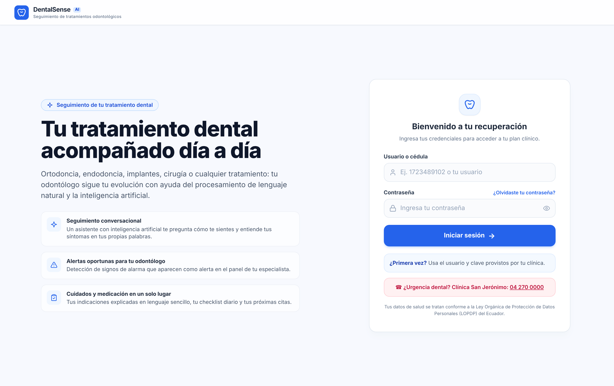
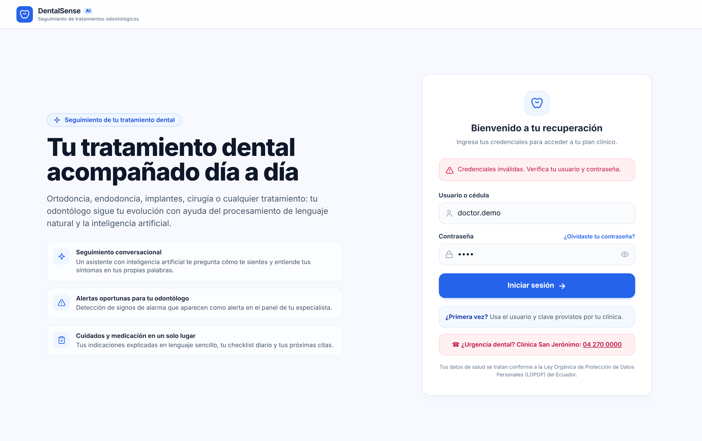
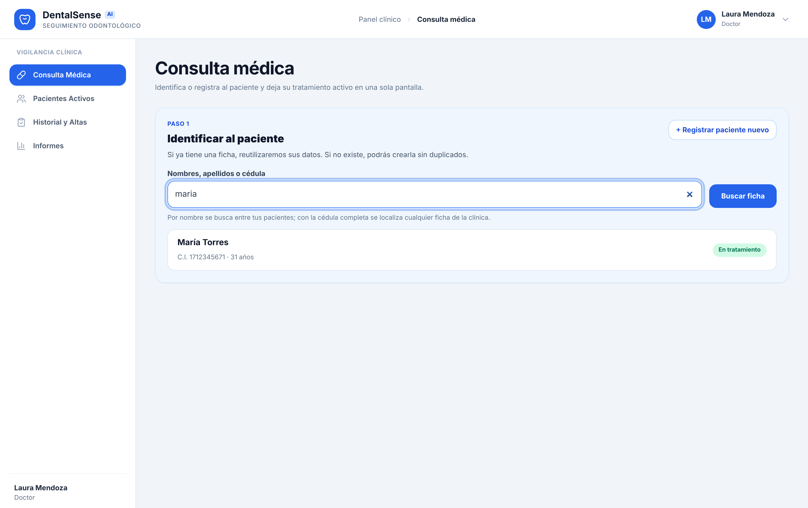
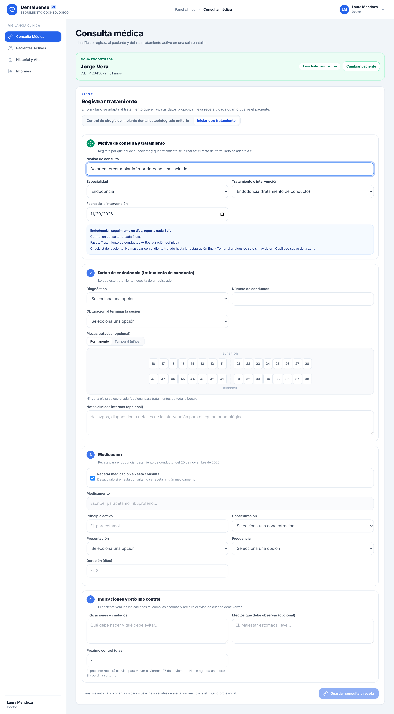
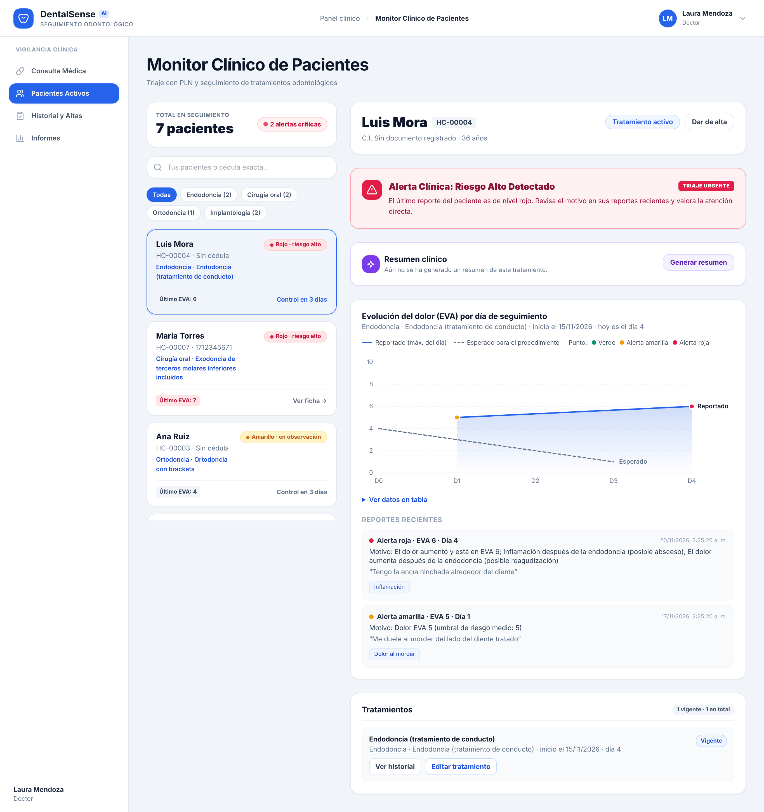
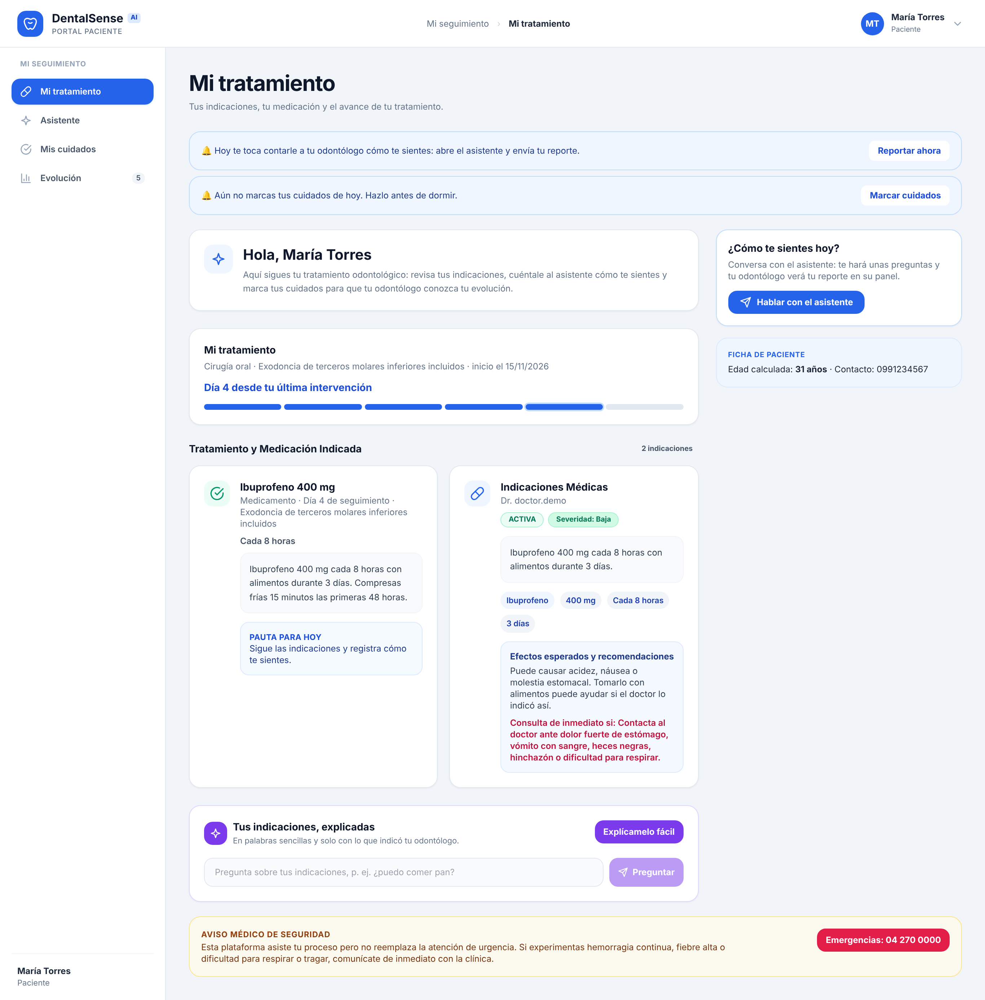
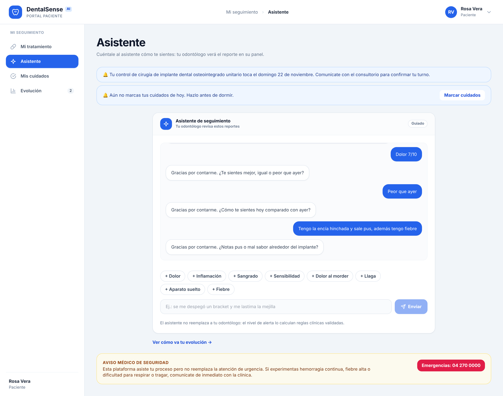
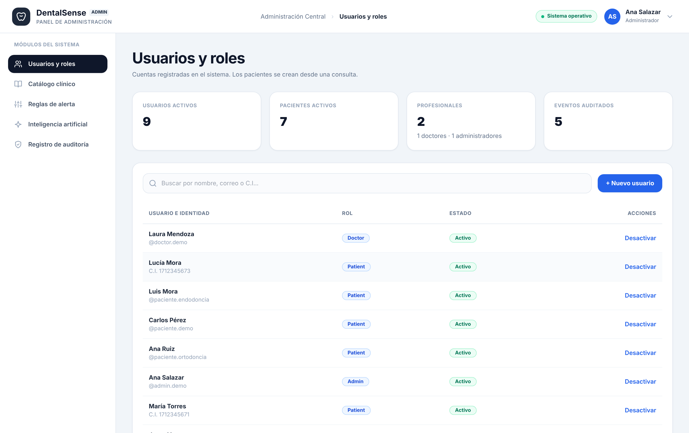
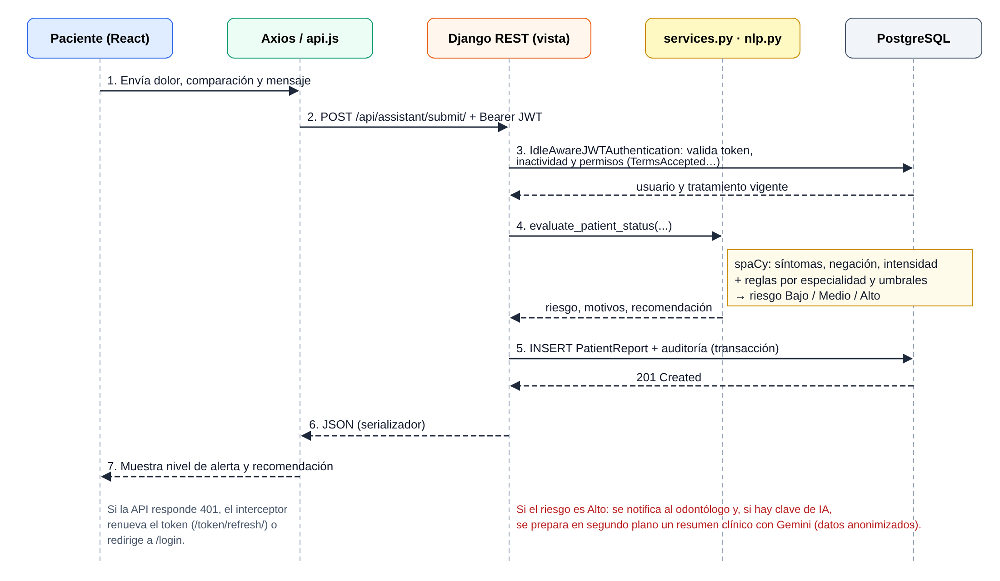
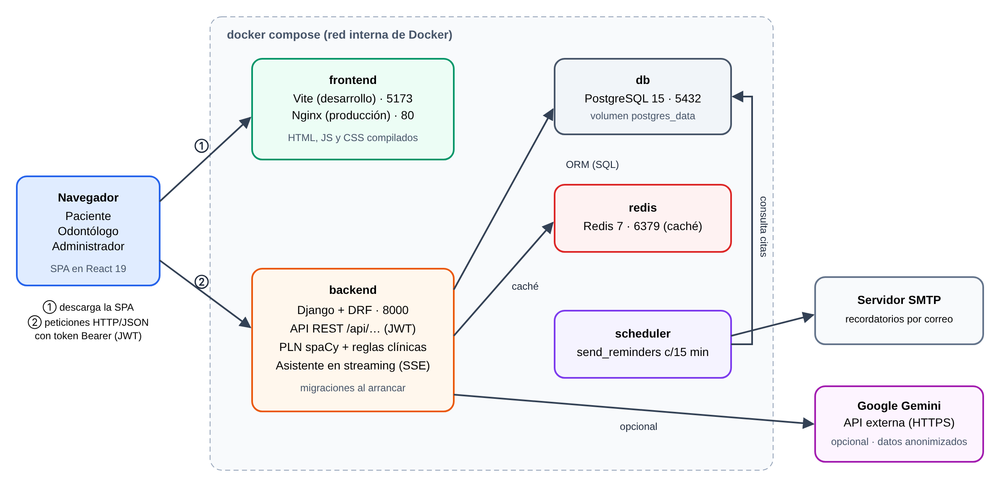

# 1. Front end

## 1.1 Estructura general de la interfaz

La interfaz de DentalSense AI es una aplicación de página única (*Single Page Application*, SPA) construida con React 19 y empaquetada con Vite. El navegador descarga una sola vez el HTML, el JavaScript y el CSS; a partir de ahí, la navegación entre pantallas ocurre en el cliente y solo se intercambian datos en formato JSON con la API REST del servidor. Este modelo, en el que el cliente mantiene el estado de la presentación y el servidor expone recursos sin estado, sigue los principios del estilo arquitectónico REST (Fielding & Taylor, 2002).

El código del cliente se organiza en carpetas según su responsabilidad:

| Carpeta | Contenido | Ejemplos |
|---|---|---|
| `src/pages/` | Una pantalla completa por archivo | `Login.jsx`, `DoctorDashboard.jsx`, `NewConsultation.jsx`, `Prescriptions.jsx` |
| `src/components/` | Piezas reutilizables de la interfaz | `Odontogram.jsx`, `AlertLevel.jsx`, `charts/PainChart.jsx`, `patient/ConversationalAssistant.jsx` |
| `src/context/` | Estado global compartido | `AuthContext.jsx` (sesión y rol del usuario) |
| `src/services/` | Comunicación con la API y lógica sin interfaz | `api.js`, `assistantStream.js`, `session.js` |
| `src/hooks/` | Hooks personalizados | `useDebouncedValue.js` |

Los estilos se escriben con clases utilitarias de Tailwind CSS directamente en el JSX (por ejemplo, `rounded-xl bg-blue-600 text-white`). Así, cada componente contiene su estructura, su comportamiento y su apariencia, y la interfaz se adapta a pantallas desde 320 px de ancho.

## 1.2 Punto de entrada y enrutamiento por roles

El archivo `main.jsx` monta la aplicación sobre el elemento `<div id="root">` de `index.html`. El componente `App.jsx` define todas las rutas con React Router y las protege según el rol del usuario: paciente (`PAT`), odontólogo (`DOC`) o administrador (`ADM`).

```jsx
// frontend/src/App.jsx (fragmento)
const DoctorDashboard = lazy(() => import('./pages/DoctorDashboard'));
const NewConsultation = lazy(() => import('./pages/NewConsultation'));

const doctor = (page) => <RoleRoute role="DOC">{page}</RoleRoute>;
const admin  = (page) => <RoleRoute role="ADM">{page}</RoleRoute>;

export default function App() {
  return (
    <BrowserRouter>
      <AuthProvider>
        <Suspense fallback={<PageLoading />}>
          <Routes>
            <Route path="/login" element={<Login />} />
            <Route path="/panel-paciente" element={<RoleRoute role="PAT"><Prescriptions /></RoleRoute>} />
            <Route path="/panel-doctor" element={doctor(<DoctorDashboard />)} />
            <Route path="/panel-doctor/consulta-medica" element={doctor(<NewConsultation />)} />
            <Route path="/panel-admin" element={admin(<AdminUsers />)} />
            <Route path="*" element={<NotFound />} />
          </Routes>
        </Suspense>
      </AuthProvider>
    </BrowserRouter>
  );
}
```

**Explicación:**

- `lazy(() => import(...))` divide el código en paquetes: cada pantalla se descarga solo cuando el usuario la visita. Un paciente nunca descarga el panel del odontólogo, lo que reduce el tiempo de carga inicial.
- `<Suspense fallback={<PageLoading />}>` muestra un esqueleto de carga mientras llega el paquete de la pantalla solicitada.
- `<AuthProvider>` envuelve todas las rutas para que cualquier componente conozca la sesión activa.
- `RoleRoute` es un componente de guarda: antes de mostrar la página verifica el rol.

```jsx
// frontend/src/components/RoleRoute.jsx (fragmento)
export default function RoleRoute({ role, children }) {
  const { isAuthenticated, role: userRole, user } = useAuth();
  if (!isAuthenticated) return <Navigate to="/login" replace />;
  if (user?.must_accept_terms) return <Navigate to="/consentimiento" replace />;
  if (userRole !== role) {
    if (userRole === 'DOC') return <Navigate to="/panel-doctor" replace />;
    if (userRole === 'ADM') return <Navigate to="/panel-admin" replace />;
    return <Navigate to="/panel-paciente" replace />;
  }
  return children;
}
```

Si el usuario no ha iniciado sesión, se le envía a `/login`. Si aún no acepta los términos de tratamiento de datos, se le envía a `/consentimiento`. Si intenta entrar a un panel que no le corresponde, se le redirige al suyo. Esta guarda solo mejora la experiencia: la seguridad real la aplica el servidor, que rechaza con `403` cualquier petición no autorizada (sección 2.4).

## 1.3 Gestión de la sesión: `AuthContext`

El contexto de autenticación usa la Context API de React para compartir, sin pasar *props* de componente en componente, el token, el rol y los datos del usuario. Sus variables de estado se crean con el hook `useState`:

```jsx
// frontend/src/context/AuthContext.jsx (fragmento)
const [token, setToken] = useState(() => localStorage.getItem('access_token'));
const [role, setRole]   = useState(() => localStorage.getItem('user_role'));
const [user, setUser]   = useState(null);

const login = async (username, password) => {
  try {
    const response = await api.post('/token/', { username, password });
    localStorage.setItem('access_token', response.data.access);
    localStorage.setItem('refresh_token', response.data.refresh);
    const currentUser = await api.get('/me/');
    localStorage.setItem('user_role', currentUser.data.role);
    setToken(response.data.access);
    setRole(currentUser.data.role);
    setUser(currentUser.data);
    navigate(homePath(currentUser.data));   // panel según el rol
    return { success: true };
  } catch (err) {
    return { success: false,
             message: err.response?.data?.detail || 'Credenciales inválidas. Verifica tu usuario y contraseña.' };
  }
};
```

- `token`, `role` y `user` son las **variables de estado**. Al cambiarlas, React vuelve a dibujar los componentes que dependen de ellas.
- La **función** `login` envía las credenciales a `POST /api/token/`. El servidor responde con dos JSON Web Tokens: uno de acceso y otro de renovación (Jones et al., 2015). Después consulta `GET /api/me/` para conocer el rol y redirige al panel que le corresponde.

El mismo contexto implementa el cierre de sesión por inactividad (requisito no funcional RNF01). Para ello escucha **eventos** del navegador:

```jsx
const ACTIVITY_EVENTS = ['pointerdown', 'keydown', 'scroll', 'touchstart'];

useEffect(() => {
  if (!token) return undefined;
  const markActive = () => { lastInteraction.current = Date.now(); };
  ACTIVITY_EVENTS.forEach((name) => window.addEventListener(name, markActive, { passive: true }));
  const timer = setInterval(() => {
    if (Date.now() - lastInteraction.current >= IDLE_TIMEOUT_MS) logout('inactividad');
  }, CHECK_INTERVAL_MS);
  return () => {                     // limpieza al desmontar
    clearInterval(timer);
    ACTIVITY_EVENTS.forEach((name) => window.removeEventListener(name, markActive));
  };
}, [token, logout]);
```

Cada clic, tecla, desplazamiento o toque actualiza la hora de la última interacción. Cada cinco segundos, un temporizador comprueba si pasaron más de cinco minutos sin actividad y, en ese caso, cierra la sesión. La función de limpieza que devuelve `useEffect` retira los escuchadores para evitar fugas de memoria.

## 1.4 Comunicación con la API: `api.js`

Todas las peticiones salen de una única instancia de Axios configurada con dos **interceptores**:

```js
// frontend/src/services/api.js (fragmento)
const api = axios.create({
  baseURL: import.meta.env.VITE_API_URL || 'http://localhost:8000/api',
  headers: { 'Content-Type': 'application/json' },
});

// 1) Antes de cada petición: adjunta el token
api.interceptors.request.use((config) => {
  const token = localStorage.getItem('access_token');
  if (token) config.headers.Authorization = 'Bearer ' + token;
  return config;
});

// 2) Después de cada respuesta: si el token caducó, lo renueva y repite la petición
api.interceptors.response.use((response) => response, async (error) => {
  if (error.response?.status === 401 && !error.config.retried) {
    await refreshAccessToken();                       // POST /token/refresh/
    return api({ ...error.config, retried: true });
  }
  return Promise.reject(error);
});
```

El interceptor de petición añade la cabecera `Authorization: Bearer <token>`, que es la forma estándar de presentar un token portador en HTTP (Jones & Hardt, 2012). El de respuesta captura el código `401 Unauthorized`, pide un nuevo token de acceso y repite la petición original sin que el usuario lo note. Si la renovación falla o la sesión se cerró por inactividad, borra los tokens y lleva al usuario a `/login`. La variable `VITE_API_URL` permite apuntar la misma compilación a un servidor local o a uno en la nube sin modificar el código.

## 1.5 Formularios y eventos: inicio de sesión y consulta médica

Los formularios siguen el patrón de **componentes controlados** de React: el valor de cada campo vive en el estado y se actualiza con el evento `onChange`. Así ocurre en la pantalla de inicio de sesión:

```jsx
// frontend/src/pages/Login.jsx (fragmento)
const [form, setForm]   = useState({ username: '', password: '' });
const [error, setError] = useState('');
const [isSubmitting, setIsSubmitting] = useState(false);

const handleChange = ({ target }) => {
  setForm((current) => ({ ...current, [target.name]: target.value }));
  setError('');
};

const handleSubmit = async (event) => {
  event.preventDefault();                       // evita recargar la página
  if (!form.username.trim() || !form.password) {
    setError('Ingresa tu usuario y contraseña para continuar.');
    return;
  }
  setIsSubmitting(true);
  const result = await login(form.username.trim(), form.password);
  if (!result.success) setError(result.message);
  setIsSubmitting(false);
};
```

`handleChange` usa el atributo `name` del campo para actualizar la propiedad correcta del objeto `form`. `handleSubmit` responde al evento `onSubmit`: primero valida en el cliente, después llama a `login` y, si falla, muestra el mensaje del servidor. Mientras espera, `isSubmitting` deshabilita el botón para evitar envíos duplicados.



Es la puerta de entrada común a los tres roles. A la izquierda se presentan las funciones del sistema; a la derecha está el formulario con el campo **Usuario o cédula**, el campo **Contraseña** (el ícono del ojo muestra u oculta lo escrito) y el botón **Iniciar sesión**. El enlace **¿Olvidaste tu contraseña?** explica cómo recuperarla en la clínica. El recuadro rojo muestra el teléfono de urgencias y el pie recuerda que los datos se tratan conforme a la LOPDP.



Si el servidor rechaza el usuario o la contraseña, el formulario muestra el mensaje de error devuelto por la API sin recargar la página, y el usuario puede corregir los datos de inmediato.

La pantalla **Consulta médica** del odontólogo es el formulario más extenso del sistema. Su función `handleSubmit` valida todos los campos y, si son correctos, envía un único objeto JSON al servidor:

```jsx
// frontend/src/components/consultation/ConsultationForm.jsx (fragmento)
const handleSubmit = async (event) => {
  event.preventDefault();
  const errors = prescribes ? validateMedication(medication) : {};
  if (!form.clinical_procedure) errors.clinical_procedure = 'Selecciona el tratamiento o intervención.';
  if (!form.surgery_date || form.surgery_date > today())
    errors.surgery_date = 'Indica una fecha de intervención que no sea futura.';
  // … más validaciones
  setFieldErrors(errors);
  if (Object.keys(errors).length > 0) return;

  try {
    const { data } = await api.post('/consultations/', {
      patient: patientId,
      admission_reason: form.admission_reason.trim(),
      clinical_procedure: Number(form.clinical_procedure),
      surgery_date: form.surgery_date,
      teeth: usesTeeth ? teeth : [],                     // piezas marcadas en el odontograma
      instructions: form.instructions.trim(),
      next_control_in_days: Number(form.next_control_in_days || 0),
      prescribes_medication: prescribes,
      ...(prescribes ? medicationPayload(medication, form.instructions) : {}),
    });
    onTreatmentAdded?.(data.treatment);
    setSuccessMsg('Consulta registrada: la receta quedó vinculada al tratamiento activo.');
  } catch (error) {
    setFieldErrors(flattenApiErrors(error.response?.data).errors);  // errores del servidor por campo
  }
};
```

La validación ocurre dos veces: en el cliente, para dar respuesta inmediata, y en el servidor, que es la autoritativa. Si el servidor devuelve `400 Bad Request`, la función `flattenApiErrors` coloca cada mensaje debajo del campo que lo originó.



El odontólogo escribe nombres, apellidos o cédula. El hook `useDebouncedValue` espera a que deje de teclear para consultar `GET /api/patients/?search=…`, lo que evita una petición por cada letra. Los resultados indican si el paciente ya tiene un tratamiento activo. El botón **+ Registrar paciente nuevo** despliega el formulario de alta sin salir de la pantalla.



Al seleccionar la **Especialidad** y el **Tratamiento o intervención**, el formulario se adapta al protocolo clínico: muestra los campos propios (en endodoncia, el diagnóstico, el número de conductos y la obturación), un resumen del seguimiento y las fases del tratamiento. El **odontograma** permite marcar las piezas tratadas según la numeración FDI. La casilla **Recetar medicación en esta consulta** muestra u oculta los campos de la receta. El botón **Guardar consulta y receta** se habilita solo cuando los campos obligatorios están completos.

## 1.6 Visualización de datos con D3.js

El panel del odontólogo dibuja la evolución del dolor del paciente según la Escala Visual Analógica (EVA, de 0 a 10), un instrumento validado para medir la intensidad del dolor (Hawker et al., 2011). La gráfica se construye con D3.js, que vincula datos a elementos SVG del documento (Bostock et al., 2011). React administra el estado (el día seleccionado) y D3 dibuja dentro de un `<svg>` referenciado con `useRef`:

```jsx
// frontend/src/components/charts/PainChart.jsx (fragmento)
const svgRef = useRef(null);
const width  = useChartWidth(boxRef);                 // ancho responsivo del contenedor
const [activeDay, setActiveDay] = useState(null);

useEffect(() => {
  if (!width || !svgRef.current) return;
  renderLineChart(svgRef.current, {
    width, height, lastDay,
    reducedMotion: prefersReducedMotion(),           // respeta la accesibilidad del sistema
    onActivate: setActiveDay,                         // evento: puntero o teclado sobre un día
    lines: [
      { key: 'expected', color: EXPECTED, dashed: true,
        points: expected.map((p) => ({ day: p.day, value: p.expected })) },
      { key: 'reported', color: REPORTED, area: true, dots: true,
        points: reported.map((p) => ({ day: p.day, value: p.reported, fill: LEVEL_FILL[p.color] })) },
    ],
  });
}, [dataKey, width]);
```

La línea punteada es la curva de dolor esperada para el procedimiento; la línea continua es lo que reportó el paciente, con cada punto coloreado según el nivel de alerta (verde, amarillo o rojo). Al pasar el puntero o navegar con el teclado aparece un *tooltip*, y el enlace **Ver datos en tabla** ofrece la misma información en formato tabular para lectores de pantalla.



Es la pantalla principal del odontólogo:

- **Columna izquierda:** el total de pacientes en seguimiento, el contador de alertas críticas, un buscador y filtros por especialidad (botones tipo *chip*). Cada tarjeta de paciente muestra su nivel de alerta, el tratamiento, el último valor EVA y la fecha del próximo control. Al hacer clic en una tarjeta, el paciente se carga en la columna derecha.
- **Columna derecha:** si el último reporte es rojo, aparece el aviso **Alerta Clínica: Riesgo Alto Detectado**. Debajo están el botón **Generar resumen**, que pide a la IA un resumen clínico; la gráfica de evolución del dolor; los **reportes recientes** con el motivo de la alerta y los síntomas detectados por el PLN como etiquetas; y la lista de tratamientos con los botones **Ver historial** y **Editar tratamiento**. El botón **Dar de alta** cierra el seguimiento.

## 1.7 Portal del paciente y asistente conversacional

El paciente informa cómo se siente mediante un asistente conversacional. Para que la respuesta aparezca mientras el modelo la escribe, el cliente consume un flujo de *Server-Sent Events* (SSE) con `fetch` y lo lee por fragmentos:

```js
// frontend/src/services/assistantStream.js (fragmento)
export async function streamAssistantMessage(payload, onDelta) {
  const response = await fetch(`${api.defaults.baseURL}/assistant/messages/stream/`, {
    method: 'POST',
    headers: { 'Content-Type': 'application/json', Accept: 'text/event-stream',
               Authorization: `Bearer ${localStorage.getItem('access_token')}` },
    body: JSON.stringify(payload),
  });
  const reader = response.body.getReader();
  const decoder = new TextDecoder();
  let buffer = '', result = null;
  for (;;) {
    const { value, done } = await reader.read();
    if (done) break;
    buffer += decoder.decode(value, { stream: true });
    // cada evento termina en "\n\n": «delta» trae texto parcial y «done» el resultado final
    // …
    if (event === 'delta') onDelta(data.text);
    else if (event === 'done') result = data;
  }
  return result;
}
```

Se usa `fetch` en lugar de `EventSource` porque este último no permite peticiones `POST` ni cabeceras de autorización. La función de retorno `onDelta` actualiza el estado del mensaje en pantalla con cada fragmento recibido.



El menú lateral da acceso a **Mi tratamiento**, **Asistente**, **Mis cuidados** y **Evolución**. Los avisos superiores recuerdan las tareas pendientes del día; sus botones **Reportar ahora** y **Marcar cuidados** llevan a la sección correspondiente. La barra de progreso indica el día de seguimiento. Las tarjetas muestran la medicación y las indicaciones del odontólogo, con los datos extraídos por el PLN (medicamento, dosis, frecuencia y duración) como etiquetas. El botón **Explícamelo fácil** pide a la IA una versión en lenguaje sencillo, y el campo **Pregunta sobre tus indicaciones** permite hacer consultas puntuales. El aviso inferior recuerda que la plataforma no reemplaza la atención de urgencia.



El paciente elige su nivel de dolor con los botones del 0 al 10, indica si está **mejor, igual o peor** que ayer y describe sus síntomas con sus propias palabras. Los botones de acceso rápido (**+ Dolor**, **+ Inflamación**, **+ Sangrado**…) añaden frases frecuentes al mensaje. El asistente repregunta según el tratamiento (en la figura, por signos de infección alrededor de un implante). Al finalizar, el botón **Enviar reporte** envía la información, y el nivel de alerta lo calculan las reglas clínicas del servidor, no el modelo de lenguaje.



El administrador ve indicadores (usuarios activos, pacientes, profesionales y eventos auditados), busca cuentas y las crea con **+ Nuevo usuario** o las desactiva con **Desactivar**. El menú lateral da acceso al **Catálogo clínico** de protocolos, a las **Reglas de alerta** (umbrales de dolor), a la configuración de **Inteligencia artificial** y al **Registro de auditoría**.

# 2. Back end

## 2.1 Arquitectura del servidor

El servidor está escrito en Python 3.12 con Django 5.0 y Django REST Framework (DRF). Sigue el patrón modelo–vista–plantilla de Django, adaptado a una API: los **modelos** definen las tablas, los **serializadores** convierten objetos en JSON y validan la entrada, las **vistas** actúan como controladores y los **servicios** concentran la lógica clínica. El proyecto se divide en aplicaciones:

| Módulo | Responsabilidad |
|---|---|
| `core/` | Configuración (`settings.py`), rutas (`urls.py`), paginación y *middleware* de rendimiento |
| `users/` | Modelo de usuario con roles, autenticación JWT con control de inactividad, permisos, cuentas y consentimiento |
| `medical_monitor/` | Recetas, tratamientos, reportes del paciente, triaje, catálogo clínico, auditoría y recordatorios |
| `medical_monitor/nlp.py` | Extracción de entidades clínicas en español con spaCy |
| `medical_monitor/rules/` | Reglas de alerta por especialidad (cirugía, endodoncia, implantes, ortodoncia, periodoncia, prótesis, operatoria) |
| `medical_monitor/ai/` | Cliente de Google Gemini, anonimización, asistente, resúmenes y explicaciones |

## 2.2 Modelos y acceso a la base de datos

Los modelos se declaran como clases de Python y el ORM de Django los traduce a tablas de PostgreSQL. El modelo de usuario extiende el de Django y añade el rol:

```python
# backend/users/models.py (fragmento)
class User(AbstractUser):
    class Roles(models.TextChoices):
        DOCTOR  = 'DOC', 'Doctor'
        PATIENT = 'PAT', 'Patient'
        ADMIN   = 'ADM', 'Admin'

    role = models.CharField(max_length=3, choices=Roles.choices, default=Roles.PATIENT)
    must_change_password = models.BooleanField(default=False)
    must_accept_terms   = models.BooleanField(default=False)
    last_activity       = models.DateTimeField(null=True, blank=True)
```

El reporte que envía el paciente guarda tanto lo que escribió como el resultado del análisis automático:

```python
# backend/medical_monitor/models.py (fragmento)
class PatientReport(TimeStampedModel):
    patient = models.ForeignKey(settings.AUTH_USER_MODEL, on_delete=models.CASCADE,
                                related_name='postoperative_reports')
    pain_level = models.PositiveSmallIntegerField()                  # EVA 0-10
    comparison = models.CharField(max_length=10, choices=Comparison.choices)
    message = models.TextField(blank=True)
    extracted_entities = models.JSONField(default=list, blank=True) # salida del PLN
    risk_level = models.CharField(max_length=20, default='Bajo')    # Bajo / Medio / Alto
    alert_reasons = models.JSONField(default=list, blank=True)
    postoperative_day = models.PositiveIntegerField(null=True, blank=True)
    treatment_plan = models.ForeignKey('TreatmentPlan', on_delete=models.SET_NULL,
                                       null=True, blank=True, related_name='reports')

    class Meta:
        indexes = [models.Index(fields=['patient', '-created_at'], name='report_patient_recent_idx')]
```

Los campos `JSONField` aprovechan el tipo `jsonb` de PostgreSQL para almacenar listas de entidades sin crear tablas adicionales. Esa extensibilidad de tipos fue un objetivo de diseño de POSTGRES desde su origen (Stonebraker & Rowe, 1986). El índice compuesto acelera la consulta más frecuente: el historial reciente de un paciente.

Las consultas se escriben con el ORM. En el listado de tratamientos se usan `select_related` (un `JOIN` de SQL) y `prefetch_related` para evitar el problema de N+1 consultas, y el conjunto de datos se filtra según quién pregunta:

```python
# backend/medical_monitor/views.py (fragmento)
class TreatmentPlanViewSet(viewsets.ModelViewSet):
    # Todo lo que usa el serializador llega en 2 consultas, sea cual sea el número de tratamientos.
    queryset = TreatmentPlan.objects.select_related(
        'patient', 'clinical_procedure', 'current_phase',
    ).prefetch_related('phases')
    serializer_class = TreatmentPlanSerializer

    def get_queryset(self):
        queryset = super().get_queryset()
        if is_patient(self.request.user):          # el paciente solo ve lo suyo y vigente
            return queryset.filter(patient=self.request.user, is_active=True)
        if self.request.user.role == self.request.user.Roles.DOCTOR:
            queryset = queryset.filter(patient__in=patients_of(self.request.user))
        return queryset
```

## 2.3 API REST: rutas y controladores

Las rutas se registran en `core/urls.py`. Un `DefaultRouter` genera automáticamente las operaciones CRUD de cada `ViewSet`, y las acciones especiales se declaran con `path`:

```python
# backend/core/urls.py (fragmento)
router = DefaultRouter()
router.register(r'prescriptions',   PrescriptionViewSet,   basename='prescription')
router.register(r'patient-reports', PatientReportViewSet,  basename='patient-report')
router.register(r'treatment-plans', TreatmentPlanViewSet,  basename='treatment-plan')
router.register(r'me',              CurrentUserViewSet,    basename='me')

urlpatterns = [
    path('api/token/',          LoginView.as_view(),   name='token_obtain_pair'),
    path('api/token/refresh/',  RefreshView.as_view(), name='token_refresh'),
    path('api/consultations/',  ConsultationCreateView.as_view()),
    path('api/assistant/messages/stream/', AssistantStreamView.as_view()),
    path('api/assistant/submit/', AssistantSubmitView.as_view()),
    path('api/', include(router.urls)),
]
```

| Método y ruta | Uso | Rol |
|---|---|---|
| `POST /api/token/` | Inicia sesión y devuelve los tokens de acceso y renovación | Todos |
| `POST /api/token/refresh/` | Renueva el token de acceso | Todos |
| `GET /api/me/` | Datos y rol del usuario autenticado | Todos |
| `GET /api/patients/?search=` · `POST /api/patients/` | Busca o registra pacientes | Odontólogo |
| `POST /api/consultations/` | Registra consulta, tratamiento y receta en una transacción | Odontólogo |
| `GET /api/treatment-plans/?patient=` | Tratamientos de un paciente | Odontólogo / paciente |
| `GET /api/patient-reports/` | Reportes del paciente con su nivel de alerta | Odontólogo / paciente |
| `POST /api/assistant/messages/stream/` | Turno del asistente en streaming (SSE) | Paciente |
| `POST /api/assistant/submit/` | Envía el reporte final para el triaje | Paciente |
| `GET /api/reports/summary/` | Indicadores para los informes | Odontólogo |
| `GET /api/audit-events/` | Registro de auditoría | Administrador |

Las rutas siguen la semántica de los métodos HTTP: `GET` consulta sin modificar, `POST` crea un recurso y responde `201 Created`, y los errores se expresan con códigos estándar como `400`, `401`, `403` y `404` (Fielding et al., 2022).

El controlador que registra una consulta muestra el ciclo completo de una petición: comprueba el rol, valida los datos, crea los registros dentro de una **transacción atómica** y responde en JSON.

```python
# backend/medical_monitor/views.py (fragmento)
class ConsultationCreateView(APIView):
    @transaction.atomic                                   # todo o nada
    def post(self, request):
        if request.user.role != request.user.Roles.DOCTOR:
            raise PermissionDenied('Solo el odontólogo puede registrar una consulta.')
        data, errors = request.data, {}
        admission_reason = text(data, 'admission_reason')
        if len(admission_reason) < 5 or len(admission_reason) > 240:
            errors['admission_reason'] = 'Describe el motivo de consulta.'
        # … validación de fecha, piezas dentales, datos del protocolo y receta
        if errors:
            return Response(errors, status=status.HTTP_400_BAD_REQUEST)

        evaluation = evaluate_treatment_plan(title, procedure, details, side_effects)
        treatment = TreatmentPlan.objects.create(patient=patient, procedure=procedure,
                        start_date=start_date, teeth=teeth,
                        treatment_severity=evaluation['severity'], …)
        if medication:
            nlp_result = analyze_medical_text(prescription_details)     # PLN sobre la receta
            prescription = Prescription.objects.create(doctor=request.user, patient=patient,
                        treatment_plan=treatment, extracted_entities=nlp_result['entities'], …)
        create_phases(treatment, clinical_procedure, start_date)
        record_audit(request.user, f'Registró consulta para {patient.username}', 'Consultas')
        return Response({'prescription': …, 'treatment': TreatmentPlanSerializer(treatment).data},
                        status=status.HTTP_201_CREATED)
```

Si cualquier paso falla, `@transaction.atomic` revierte todos los cambios, de modo que no quedan tratamientos sin receta ni recetas huérfanas. Cada acción relevante deja un evento en el registro de auditoría.

## 2.4 Autenticación, permisos y manejo de sesiones

La API es **sin estado**: no guarda sesiones en el servidor. Cada petición presenta un JWT firmado, que contiene el identificador del usuario y su fecha de expiración (Jones et al., 2015). La configuración global bloquea todo por defecto:

```python
# backend/core/settings.py (fragmento)
REST_FRAMEWORK = {
    'DEFAULT_PAGINATION_CLASS': 'core.pagination.StandardPagination',
    'DEFAULT_AUTHENTICATION_CLASSES': ('users.authentication.IdleAwareJWTAuthentication',),
    'DEFAULT_PERMISSION_CLASSES': [
        'rest_framework.permissions.IsAuthenticated',
        'users.permissions.TermsAccepted',
        'users.permissions.PasswordChangeCompleted',
    ],
    'DEFAULT_THROTTLE_RATES': {'login': '10/min', 'assistant': '30/min', 'ai': '20/hour'},
}
SIMPLE_JWT = {
    'ACCESS_TOKEN_LIFETIME': timedelta(minutes=SESSION_IDLE_TIMEOUT_MINUTES),  # 5 min
    'REFRESH_TOKEN_LIFETIME': timedelta(days=1),
    'AUTH_HEADER_TYPES': ('Bearer',),
    'CHECK_REVOKE_TOKEN': True,   # cambiar la contraseña invalida los tokens anteriores
}
```

- **Autenticación:** la clase personalizada `IdleAwareJWTAuthentication` hereda de la de Simple JWT, valida la firma del token y, además, rechaza la petición si el usuario lleva más de cinco minutos inactivo:

```python
# backend/users/authentication.py (fragmento)
class IdleAwareJWTAuthentication(JWTAuthentication):
    def authenticate(self, request):
        result = super().authenticate(request)          # valida firma y expiración del JWT
        if result is None:
            return None
        user, token = result
        ensure_not_idle(user)                            # 401 con code='session_idle'
        if request.headers.get('X-Background-Request') != '1':
            touch(user)                                  # renueva la última actividad
        return user, token
```

- **Permisos:** `IsAuthenticated` exige un token válido. `TermsAccepted` y `PasswordChangeCompleted` bloquean la API hasta que el paciente acepte el tratamiento de sus datos y cambie su contraseña temporal. Dentro de cada vista se comprueba además el rol (por ejemplo, `require_doctor`).
- **Límites de uso (*throttling*):** como máximo 10 intentos de inicio de sesión por minuto, lo que frena ataques de fuerza bruta, y límites en las llamadas a la IA para acotar su costo. Los contadores se guardan en Redis.

## 2.5 Servicios: procesamiento de lenguaje natural y triaje

La lógica principal del sistema es clasificar cada reporte del paciente en verde, amarillo o rojo. La extracción de información clínica a partir de texto libre es una aplicación consolidada del PLN en salud, en la que los enfoques basados en reglas siguen siendo los más usados por su transparencia (Wang et al., 2018). El módulo `nlp.py` usa spaCy (Honnibal et al., 2020) con un `EntityRuler` que reconoce síntomas, medicamentos, dosis y frecuencias en español, y detecta además la negación y la intensidad:

```python
# backend/medical_monitor/nlp.py (fragmento)
SYMPTOMS = {
    'Dolor':       ['dolor|dolores|duele|duelen|molestia|molestias|punzada|punzante'],
    'Inflamación': ['inflamacion|inflamado|hinchazon|hinchado|edema'],
    'Fiebre':      ['fiebre|calentura|febril'],
    'Signos de infección': ['pus|supura|supuracion', ['mal', 'olor|sabor|aliento']],
    'Apertura bucal limitada': ['trismo', ['no', 'puedo|logro', 'abrir', 'la?', 'boca']],
    # …
}
```

Así, una frase como «ya no me duele» se marca como síntoma negado y no genera alerta. El servicio `evaluate_patient_status` combina el análisis del texto con el valor EVA, la tendencia y las reglas del protocolo del tratamiento:

```python
# backend/medical_monitor/services.py (fragmento)
def evaluate_patient_status(pain_level, comparison, message, previous_report=None,
                            postoperative_day=None, protocol=None):
    analysis = analyze_medical_text(message)            # spaCy
    thresholds = AlertSettings.load()                   # umbrales configurables por el administrador
    findings = []
    if pain_level >= thresholds.high_pain:
        findings.append(('Alto', f'Dolor EVA {pain_level} (umbral de riesgo alto: {thresholds.high_pain})'))
    elif pain_level >= thresholds.medium_pain:
        findings.append(('Medio', f'Dolor EVA {pain_level} (umbral de riesgo medio: {thresholds.medium_pain})'))
    if comparison == 'higher' and pain_level >= thresholds.rising_pain:
        findings.append(('Alto', f'El dolor aumentó y está en EVA {pain_level}'))
    findings += rules.evaluate(rules.RuleContext(        # reglas por especialidad y día
        symptoms=affirmed_symptoms(analysis['entities']), pain_level=pain_level,
        day=postoperative_day, thresholds=thresholds, protocol=protocol, …))

    risk_level = max((level for level, _ in findings), key=RISK_RANK.get, default='Bajo')
    return {'risk_level': risk_level, 'alert_color': ALERT_COLORS[risk_level],
            'alert_reasons': [...], 'recommendation': ..., 'doctor_notified': risk_level == 'Alto'}
```

Cada especialidad tiene su archivo de reglas. Por ejemplo, la regla común `rules/base.py` eleva a riesgo alto la fiebre con signos de infección y cualquier dificultad para tragar o respirar, y marca como riesgo medio un síntoma que persiste más días de los esperados para el procedimiento. El resultado incluye los **motivos** de la alerta, de modo que el odontólogo sabe por qué se clasificó así el reporte.

## 2.6 Integración con la IA generativa

El módulo `ai/` usa Google Gemini (Gemini Team, 2023) para tres tareas de apoyo: conversar con el paciente, resumir la evolución clínica para el odontólogo y explicar las indicaciones en lenguaje sencillo. Los modelos de lenguaje tienen un gran potencial en medicina, pero también riesgos de errores y de privacidad (Thirunavukarasu et al., 2023). Por eso el diseño aplica dos salvaguardas:

1. **El triaje nunca depende del modelo.** El nivel de alerta siempre lo calculan las reglas de la sección 2.5. Si no hay clave de la API o el servicio falla, el sistema usa sus alternativas locales.
2. **Anonimización.** Los ataques de reidentificación sobre datos de salud están documentados (El Emam et al., 2011), por lo que al modelo solo se envía el contexto clínico mínimo, sin identificadores:

```python
# backend/medical_monitor/ai/anonymize.py (fragmento)
def plan_context(plan):
    """Contexto clínico mínimo y sin identificadores para el modelo."""
    return {
        'edad': age_text(plan.patient.age),             # años, nunca la fecha de nacimiento
        'especialidad': procedure.get_specialty_display(),
        'tratamiento': procedure.name,
        'dia_de_seguimiento': plan.postoperative_day,
        'piezas_dentales_fdi': plan.teeth or [],
        'medicacion': ' '.join(filter(None, (plan.medication_name, plan.strength, plan.frequency))),
    }
```

Además, las expresiones regulares del mismo módulo eliminan del texto teléfonos, correos y fechas antes de enviarlo. Cada respuesta del modelo se pide en formato JSON, se valida con Pydantic y queda registrada en la tabla `AIInteraction` para su auditoría.

El asistente responde en *streaming*. La vista devuelve un `StreamingHttpResponse` con tipo `text/event-stream`, y cada fragmento sale en cuanto el modelo lo produce:

```python
# backend/medical_monitor/views_followup.py (fragmento)
def sse(event, data):
    return f'event: {event}\ndata: {json.dumps(data, ensure_ascii=False)}\n\n'

class AssistantStreamView(AssistantView):
    def post(self, request):
        events = assistant.message_events(request.user, *self._message(request), stream=True)
        first = next(events)          # un mensaje no válido responde 400 normal, no un flujo roto
        def body():
            kind, value = first
            while True:
                yield sse(kind, {'text': value} if kind == 'delta' else value)
                kind, value = next(events)
        response = StreamingHttpResponse(body(), content_type='text/event-stream; charset=utf-8')
        response['Cache-Control'] = 'no-cache'
        response['X-Accel-Buffering'] = 'no'          # Nginx no debe acumular la respuesta
        return response
```

## 2.7 Flujo de peticiones y respuestas entre frontend y backend

La Figura 9 resume lo que ocurre cuando el paciente envía su reporte diario.




1. El componente `ConversationalAssistant` reúne el dolor, la comparación con el día anterior y el mensaje.
2. `api.js` envía `POST /api/assistant/submit/` con la cabecera `Authorization: Bearer <token>`.
3. Django autentica el token, comprueba la inactividad y aplica los permisos. Si algo falla, responde `401` o `403`.
4. La vista llama a `evaluate_patient_status`, que ejecuta spaCy y las reglas clínicas.
5. El reporte se guarda en PostgreSQL junto con su evento de auditoría.
6. El serializador convierte el resultado en JSON y lo devuelve con `201 Created`.
7. React actualiza la pantalla con el nivel de alerta y la recomendación.

Si el riesgo es alto, el odontólogo recibe la notificación y, si la IA está activa, se prepara en segundo plano un resumen clínico.

Este es un fragmento real de la respuesta JSON de `GET /api/patient-reports/` para un reporte clasificado en rojo:

```json
{
  "count": 5,
  "next": "http://localhost:8000/api/patient-reports/?page=2&page_size=1",
  "results": [{
    "id": 13,
    "pain_level": 7,
    "comparison": "higher",
    "message": "El dolor aumentó mucho y tengo fiebre",
    "extracted_entities": [
      {"text": "dolor",  "label": "SINTOMA", "negated": false, "category": "Dolor",  "intensity": "alta"},
      {"text": "fiebre", "label": "SINTOMA", "negated": false, "category": "Fiebre", "intensity": null}
    ],
    "risk_level": "Alto",
    "alert_color": "rojo",
    "doctor_notified": true,
    "evolution_status": "Requiere revisión",
    "alert_reasons": [
      "Dolor EVA 7 (umbral de riesgo alto: 7)",
      "El dolor aumentó y está en EVA 7",
      "El dolor aumenta después del día 3 (posible alveolitis)"
    ],
    "postoperative_day": 4
  }]
}
```

La respuesta llega paginada (`count`, `next`), incluye las entidades que extrajo el PLN con su negación e intensidad, y explica en `alert_reasons` cada motivo de la alerta. La misma petición sin token devuelve `401 Unauthorized`.

# 3. Integración del sistema

## 3.1 Capas y conexión entre módulos

DentalSense AI se compone de tres capas que se comunican por la red:

- **Presentación:** la SPA de React que se ejecuta en el navegador.
- **Lógica:** la API de Django, que concentra la autenticación, las reglas, el PLN y la IA.
- **Datos:** PostgreSQL como almacenamiento persistente y Redis como caché.

Además, dos servicios externos son opcionales: Google Gemini para la IA generativa y un servidor SMTP para los recordatorios por correo.



Cada componente corre en su propio contenedor dentro de una red interna de Docker:

- El navegador descarga la SPA del contenedor `frontend` (①) y después habla directamente con la API del contenedor `backend` (②).
- El `backend` llega a la base de datos y a la caché por el nombre del servicio (`db`, `redis`), que Docker resuelve como nombre de host.
- El contenedor `scheduler` reutiliza la misma imagen del backend para enviar recordatorios cada 15 minutos.

Las conexiones se configuran exclusivamente mediante variables de entorno:

| Conexión | Variable | Valor en Docker |
|---|---|---|
| Frontend → Backend | `VITE_API_URL` | `http://localhost:8000/api` |
| Backend → PostgreSQL | `DB_HOST`, `DB_PORT`, `DB_NAME`, `DB_USER`, `DB_PASSWORD` | `db`, `5432`, `mi_base_datos`, `admin`, (desde `.env`) |
| Backend → Redis | `CACHE_URL` | `redis://redis:6379/1` |
| Backend → Gemini | `GEMINI_API_KEY`, `AI_MODEL` | clave de Google AI Studio (opcional) |
| Backend acepta al Frontend | `CORS_ALLOWED_ORIGINS` | `http://localhost:5173` |

Como el frontend (puerto 5173) y la API (puerto 8000) tienen orígenes distintos, el navegador aplicaría la política del mismo origen; `django-cors-headers` autoriza explícitamente al origen del frontend.

## 3.2 Entorno de ejecución y despliegue

El prototipo funcional se ejecuta **en local** con Docker Compose. Los contenedores encapsulan cada servicio con sus dependencias exactas, lo que hace el entorno reproducible en cualquier equipo (Boettiger, 2015) y facilita trasladarlo después a una plataforma en la nube (Pahl, 2015). El archivo `docker-compose.yml` define cinco servicios:

```yaml
# docker-compose.yml (fragmento)
services:
  db:
    image: postgres:15-alpine
    volumes: [postgres_data:/var/lib/postgresql/data]   # los datos sobreviven a reinicios
    environment: { POSTGRES_DB: mi_base_datos, POSTGRES_USER: admin,
                   POSTGRES_PASSWORD: "${DB_PASSWORD:-admin_password}" }
    ports: ["5432:5432"]

  redis:
    image: redis:7-alpine
    command: redis-server --save "" --maxmemory 64mb --maxmemory-policy allkeys-lru

  backend:
    build: { context: ./backend }
    command: bash -c "python manage.py migrate && python manage.py runserver 0.0.0.0:8000"
    ports: ["8000:8000"]
    environment:
      - DB_HOST=db
      - CACHE_URL=redis://redis:6379/1
      - GEMINI_API_KEY=${GEMINI_API_KEY:-}
    depends_on: [db, redis]

  scheduler:
    build: { context: ./backend }
    command: bash -c "while true; do python manage.py send_reminders; sleep 900; done"
    depends_on: [backend]

  frontend:
    build: { context: ./frontend }
    command: sh -c "npm install --no-audit --no-fund && npm run dev"
    ports: ["5173:5173"]
    environment: [VITE_API_URL=http://localhost:8000/api]
    depends_on: [backend]
```

| Servicio | Imagen base | Puerto | Función |
|---|---|---|---|
| `db` | `postgres:15-alpine` | 5432 | Base de datos persistente (volumen `postgres_data`) |
| `redis` | `redis:7-alpine` | 6379 (interno) | Caché de catálogos y contadores de límite de uso |
| `backend` | `python:3.12-slim` + spaCy `es_core_news_sm` | 8000 | API REST; aplica las migraciones al arrancar |
| `scheduler` | misma imagen del backend | — | Recordatorios de citas, reportes y cuidados |
| `frontend` | `node:20-alpine` | 5173 | Servidor de desarrollo de Vite |

El `Dockerfile` del backend instala las dependencias del sistema (`gcc`, `libpq-dev`), luego los paquetes de `requirements.txt` y descarga el modelo de spaCy en español. Copiar `requirements.txt` antes que el resto del código aprovecha la caché de capas de Docker: si solo cambia el código, las dependencias no se reinstalan.

**Pasos para ejecutar el prototipo:**

1. Clonar el repositorio y copiar el archivo de configuración: `cp .env.example .env` (opcionalmente se añade `GEMINI_API_KEY`).
2. Construir y levantar los servicios: `docker compose up --build`.
3. Cargar datos de demostración: `docker compose exec backend python manage.py seed_demo` (borra los datos existentes).
4. Abrir `http://localhost:5173` e ingresar, por ejemplo, con `doctor.demo` / `DoctorDemo2026!` o `paciente.demo` / `PacienteDemo2026!`.

**Producción.** El archivo `frontend/Dockerfile.prod` compila la SPA con Vite en una primera etapa y la sirve con Nginx 1.27 en una segunda, con archivos precomprimidos en gzip y la URL de la API definida en tiempo de compilación (`--build-arg VITE_API_URL=https://api.midominio.com/api`). En ese escenario se configura `DEBUG=False` y `SECRET_KEY` (obligatoria), y se amplía `CORS_ALLOWED_ORIGINS` con el dominio público.

**Verificación.** Las pruebas automatizadas comprueban la integración de cada capa: `python manage.py test --settings=core.settings_test` en el backend (con SQLite en memoria) y `npm test` (Vitest) en el frontend.

## 3.3 Flujo general de uso del sistema

El ciclo completo de seguimiento de un paciente recorre los tres roles y todas las capas:

1. **Administrador:** configura el catálogo de tratamientos, los umbrales de alerta y las cuentas del personal (Figura 8).
2. **Odontólogo — consulta:** busca o registra al paciente y registra el tratamiento, las piezas dentales, la receta y la fecha del próximo control (Figuras 3 y 4). El backend crea el plan, sus fases y la receta en una sola transacción. Al paciente nuevo se le generan credenciales temporales.
3. **Paciente — primer acceso:** inicia sesión (Figura 1), acepta el tratamiento de sus datos, cambia su contraseña y ve sus indicaciones y su medicación en lenguaje sencillo (Figura 6).
4. **Paciente — seguimiento diario:** conversa con el asistente y envía su reporte (Figura 7). El backend lo clasifica con PLN y reglas (Figura 9), y el `scheduler` le recuerda por correo los reportes y controles pendientes.
5. **Odontólogo — vigilancia:** en el Monitor Clínico ve primero a los pacientes con alerta roja, revisa la curva de dolor y los motivos de la alerta, genera un resumen con IA y decide si llamar al paciente, adelantar el control o darle el alta (Figura 5).

Este flujo responde a la evidencia de que el monitoreo remoto en casa tras una intervención es viable y bien aceptado por los pacientes (Dawes et al., 2021). En DentalSense AI, la integración de las capas permite que la información que el paciente escribe desde su teléfono llegue clasificada al panel del odontólogo en pocos segundos.

# Referencias

Boettiger, C. (2015). An introduction to Docker for reproducible research. *ACM SIGOPS Operating Systems Review, 49*(1), 71–79. https://doi.org/10.1145/2723872.2723882

Bostock, M., Ogievetsky, V., & Heer, J. (2011). D³ data-driven documents. *IEEE Transactions on Visualization and Computer Graphics, 17*(12), 2301–2309. https://doi.org/10.1109/TVCG.2011.185

Dawes, A. J., Lin, A. Y., Varghese, C., Russell, M. M., & Lin, A. Y. (2021). Mobile health technology for remote home monitoring after surgery: A meta-analysis. *British Journal of Surgery, 108*(11), 1304–1314. https://doi.org/10.1093/bjs/znab323

El Emam, K., Jonker, E., Arbuckle, L., & Malin, B. (2011). A systematic review of re-identification attacks on health data. *PLoS ONE, 6*(12), Artículo e28071. https://doi.org/10.1371/journal.pone.0028071

Fielding, R. T., Nottingham, M., & Reschke, J. (Eds.). (2022). *HTTP semantics* (RFC 9110). RFC Editor. https://doi.org/10.17487/RFC9110

Fielding, R. T., & Taylor, R. N. (2002). Principled design of the modern Web architecture. *ACM Transactions on Internet Technology, 2*(2), 115–150. https://doi.org/10.1145/514183.514185

Gemini Team. (2023). *Gemini: A family of highly capable multimodal models* (arXiv:2312.11805). arXiv. https://doi.org/10.48550/arXiv.2312.11805

Hawker, G. A., Mian, S., Kendzerska, T., & French, M. (2011). Measures of adult pain: Visual Analog Scale for Pain (VAS Pain), Numeric Rating Scale for Pain (NRS Pain), McGill Pain Questionnaire (MPQ), Short-Form McGill Pain Questionnaire (SF-MPQ), Chronic Pain Grade Scale (CPGS), Short Form-36 Bodily Pain Scale (SF-36 BPS), and Measure of Intermittent and Constant Osteoarthritis Pain (ICOAP). *Arthritis Care & Research, 63*(S11), S240–S252. https://doi.org/10.1002/acr.20543

Honnibal, M., Montani, I., Van Landeghem, S., & Boyd, A. (2020). *spaCy: Industrial-strength natural language processing in Python* [Software]. Zenodo. https://doi.org/10.5281/zenodo.1212303

Jones, M., Bradley, J., & Sakimura, N. (2015). *JSON Web Token (JWT)* (RFC 7519). RFC Editor. https://doi.org/10.17487/RFC7519

Jones, M., & Hardt, D. (2012). *The OAuth 2.0 authorization framework: Bearer token usage* (RFC 6750). RFC Editor. https://doi.org/10.17487/RFC6750

Pahl, C. (2015). Containerization and the PaaS cloud. *IEEE Cloud Computing, 2*(3), 24–31. https://doi.org/10.1109/MCC.2015.51

Stonebraker, M., & Rowe, L. A. (1986). The design of POSTGRES. *ACM SIGMOD Record, 15*(2), 340–355. https://doi.org/10.1145/16856.16888

Thirunavukarasu, A. J., Ting, D. S. J., Elangovan, K., Gutierrez, L., Tan, T. F., & Ting, D. S. W. (2023). Large language models in medicine. *Nature Medicine, 29*(8), 1930–1940. https://doi.org/10.1038/s41591-023-02448-8

Wang, Y., Wang, L., Rastegar-Mojarad, M., Moon, S., Shen, F., Afzal, N., Liu, S., Zeng, Y., Mehrabi, S., Sohn, S., & Liu, H. (2018). Clinical information extraction applications: A literature review. *Journal of Biomedical Informatics, 77*, 34–49. https://doi.org/10.1016/j.jbi.2017.11.011
