# Desarrollo

## Tecnologías y herramientas

DentalSense AI es una aplicación web para el seguimiento postoperatorio odontológico. Sigue una arquitectura cliente-servidor desacoplada: un **frontend** en React que consume una **API REST** construida con Django REST Framework, respaldada por una base de datos PostgreSQL, una caché Redis y un módulo de inteligencia artificial que combina procesamiento de lenguaje natural (PLN) local con un modelo de lenguaje generativo. A continuación se describen las tecnologías empleadas en cada capa, los motivos de su elección y cómo contribuyen al desarrollo del proyecto.

### Resumen de tecnologías

| Capa | Tecnología | Versión | Función en el proyecto |
|---|---|---|---|
| Servidor | Python | 3.12 | Lenguaje del backend |
| Servidor | Django | 5.0 | Framework web: modelos, ORM, migraciones, administración |
| Servidor | Django REST Framework | 3.15 | Construcción de la API REST |
| Servidor | djangorestframework-simplejwt | 5.3 | Autenticación con tokens JWT |
| Servidor | django-cors-headers | 4.4 | Permitir peticiones del frontend (CORS) |
| Servidor | django-environ | 0.14 | Configuración por variables de entorno (`.env`) |
| IA / PLN | spaCy + `es_core_news_sm` | 3.8 | Extracción de síntomas, medicamentos y dosis en español |
| IA generativa | Google Gemini (SDK `google-genai`) | 3.3 | Asistente conversacional, resúmenes clínicos y explicaciones |
| IA generativa | Pydantic | — | Validación de las respuestas JSON del modelo |
| Datos | PostgreSQL | 15 | Base de datos relacional principal |
| Datos | psycopg2 | 2.9 | Conector de Python con PostgreSQL |
| Datos | Redis | 7 | Caché compartida de catálogos y límites de uso |
| Cliente | JavaScript (JSX) | ES2022+ | Lenguaje del frontend |
| Cliente | React | 19 | Biblioteca de interfaces basada en componentes |
| Cliente | React Router | 7 | Navegación y rutas protegidas por rol |
| Cliente | Vite | 8 | Servidor de desarrollo y empaquetado |
| Cliente | Tailwind CSS (+ PostCSS, Autoprefixer) | 3.4 | Estilos y diseño responsivo |
| Cliente | Axios | 1.x | Cliente HTTP para consumir la API |
| Cliente | D3.js | 7 | Gráficas de evolución del dolor, adherencia y reportes |
| Pruebas | Django TestCase (SQLite en memoria) | — | Pruebas unitarias y de API del backend |
| Pruebas | Vitest + Testing Library + jsdom | 5 / 16 | Pruebas de componentes y páginas del frontend |
| Calidad | Oxlint | 1.x | Análisis estático (linter) del código JavaScript |
| Despliegue | Docker y Docker Compose | — | Contenedores para base de datos, caché, backend, tareas y frontend |
| Despliegue | Node.js | 20 | Entorno de ejecución para instalar dependencias y compilar el frontend |
| Despliegue | Nginx | 1.27 | Servidor de los archivos estáticos del frontend en producción |
| Desarrollo | Visual Studio Code | — | Entorno de desarrollo (IDE) |
| Desarrollo | Git y GitHub | — | Control de versiones y repositorio remoto |

### Tecnologías del lado del servidor (backend)

**Python 3.12.** Se eligió como lenguaje del servidor por su sintaxis clara, su amplia comunidad y, sobre todo, porque concentra las bibliotecas de referencia en PLN e inteligencia artificial. Al usar el mismo lenguaje para la API y para el análisis de texto, la lógica clínica y el procesamiento de lenguaje conviven en un solo proyecto sin servicios intermedios.

**Django 5.0.** Es el framework web principal. Ofrece un ORM para definir los modelos (pacientes, consultas, tratamientos, reportes, alertas, auditoría) sin escribir SQL a mano, un sistema de migraciones que versiona la estructura de la base de datos, un panel de administración listo para usar, y protecciones de seguridad integradas (contraseñas cifradas, protección contra inyección SQL, XSS y CSRF). Su enfoque de «baterías incluidas» redujo el tiempo de desarrollo, y sus comandos de gestión permitieron automatizar tareas como el envío de recordatorios (`send_reminders`), la carga de datos de demostración (`seed_demo`) y la evaluación del módulo de PLN (`evaluate_nlp`).

**Django REST Framework (DRF).** Convierte los modelos de Django en una API REST mediante serializadores, vistas y permisos. Facilita la validación de datos de entrada, la paginación de resultados y el control de acceso por rol (administrador, odontólogo y paciente), lo que mantiene la API coherente y fácil de ampliar, siguiendo los principios del estilo arquitectónico REST (Fielding & Taylor, 2002).

**Simple JWT.** Implementa la autenticación con JSON Web Tokens. Al ser un mecanismo sin estado, el frontend guarda el token y lo envía en cada petición, lo que encaja con una arquitectura en la que cliente y servidor están separados (Jones et al., 2015).

**django-cors-headers y django-environ.** El primero permite que el frontend, servido en otro origen (puerto 5173 en desarrollo), consuma la API de forma controlada. El segundo carga la configuración (credenciales de base de datos, clave secreta, clave de la API de IA) desde un archivo `.env`, de modo que ningún secreto queda escrito en el código fuente.

### Inteligencia artificial y procesamiento de lenguaje natural

**spaCy con el modelo `es_core_news_sm`.** Es el motor local de PLN que analiza los reportes que escriben los pacientes en español. Mediante un `EntityRuler` reconoce síntomas (dolor, inflamación, sangrado, fiebre, signos de infección, etc.), medicamentos, dosis y frecuencias, y estima la intensidad de cada síntoma y si está negado («ya no me duele»). Junto con un motor de reglas clínicas por especialidad (cirugía, endodoncia, implantes, ortodoncia, periodoncia, prótesis y operatoria), determina el nivel de alerta del paciente. Se eligió porque es rápido, funciona sin conexión, tiene buen soporte para el español y produce resultados explicables, algo indispensable en un contexto clínico (Honnibal et al., 2020; Wang et al., 2018).

**Google Gemini (SDK oficial `google-genai`).** Se usa (Gemini Team, 2023) como complemento para el asistente conversacional del paciente, los resúmenes clínicos para el odontólogo y las explicaciones en lenguaje sencillo. Cada llamada solicita una salida JSON validada con **Pydantic** y queda registrada para su auditoría. Se seleccionó por la calidad de su generación en español y su caché implícita de instrucciones, que reduce costos. Dos decisiones de diseño refuerzan la seguridad: los datos se **anonimizan** antes de enviarse (no salen nombres, cédulas, teléfonos, correos ni fechas exactas, conforme a la LOPDP y para reducir el riesgo de reidentificación descrito por El Emam et al., 2011), y la IA generativa **nunca es imprescindible**: si no hay clave o el servicio falla, el sistema usa sus alternativas locales y el triaje sigue a cargo del motor de PLN y reglas.

### Gestión de datos

**PostgreSQL 15.** Es el gestor de base de datos relacional. Se eligió por su robustez, su cumplimiento de las propiedades ACID (indispensable para datos clínicos), su buen rendimiento con consultas complejas y su integración nativa con Django a través del conector **psycopg2**. Desde su diseño original, POSTGRES priorizó la extensibilidad de tipos de datos (Stonebraker & Rowe, 1986), que el proyecto aprovecha al guardar en JSON las entidades extraídas por el PLN.

**Redis 7.** Actúa como caché compartida en memoria para los catálogos clínicos y los límites de uso de la IA. Reduce la carga sobre la base de datos y acelera las respuestas de la API. Es opcional: sin Redis, el backend usa la memoria del propio proceso.

### Tecnologías del lado del cliente (frontend)

**React 19 con JavaScript (JSX).** Es la biblioteca con la que se construye la interfaz. Su modelo de componentes reutilizables (formularios de consulta, odontograma, tarjetas de alerta, gráficas) permitió crear tres paneles diferenciados —administrador, odontólogo y paciente— compartiendo piezas comunes. El estado de la sesión se gestiona con la Context API (`AuthContext`).

**React Router 7.** Gestiona la navegación entre páginas y protege las rutas según la autenticación y el rol del usuario (`ProtectedRoute`, `RoleRoute`).

**Vite 8.** Es la herramienta de construcción. Su servidor de desarrollo con recarga instantánea agiliza el trabajo diario, y en producción genera archivos optimizados y minificados.

**Tailwind CSS.** Framework de estilos basado en clases utilitarias que permitió diseñar una interfaz consistente y adaptable a móviles sin escribir hojas de estilo extensas. Se procesa con **PostCSS** y **Autoprefixer** para asegurar compatibilidad entre navegadores.

**Axios.** Cliente HTTP con el que el frontend se comunica con la API. Centraliza la URL base y añade automáticamente el token JWT a cada petición.

**D3.js.** Biblioteca de visualización con la que se construyeron las gráficas de evolución del dolor, adherencia al tratamiento y reportes. Se prefirió frente a librerías de gráficos cerradas por el control total que ofrece sobre el diseño, las animaciones y la accesibilidad (Bostock et al., 2011).

### Pruebas y calidad de código

- **Backend:** el sistema de pruebas de Django cubre modelos, servicios, API, reglas clínicas, IA, migraciones y rendimiento. Usa una base SQLite en memoria para que las pruebas sean rápidas y no afecten datos reales.
- **Frontend:** **Vitest** junto con **React Testing Library**, **user-event** y **jsdom** prueba componentes y páginas simulando la interacción del usuario.
- **Oxlint:** analizador estático muy rápido que detecta errores y malas prácticas en el código JavaScript.

Estas herramientas permitieron detectar fallos de forma temprana y modificar el código con confianza, ya que las pruebas automatizadas pueden repetirse después de cada cambio (Garousi & Mäntylä, 2016).

### Entorno de desarrollo, despliegue y control de versiones

**Visual Studio Code.** Fue el entorno de desarrollo integrado (IDE) utilizado. Se eligió por ser gratuito y ligero, y por sus extensiones para Python, Django, React, Tailwind CSS, Docker y Git, que permiten trabajar ambas capas del proyecto desde un mismo editor.

**Docker y Docker Compose.** Todo el sistema se ejecuta en contenedores con un solo comando (`docker compose up --build`): base de datos PostgreSQL, caché Redis, backend Django (que aplica las migraciones al arrancar), un programador que envía recordatorios por correo cada 15 minutos, y el frontend. Así se garantiza que el entorno sea idéntico en cualquier equipo y se elimina el problema de «en mi máquina sí funciona» (Boettiger, 2015; Pahl, 2015).

**Node.js 20 y npm.** Entorno de ejecución y gestor de paquetes con los que se instalan las dependencias y se compila el frontend.

**Nginx.** En producción, una imagen Docker de varias etapas compila el frontend con Vite y lo sirve con Nginx, con archivos precomprimidos (gzip) para responder más rápido.

**Git y GitHub.** Git se usó para el control de versiones y GitHub como repositorio remoto. Permiten conservar el historial de cambios, trabajar en ramas independientes y respaldar el proyecto en la nube.

### Contribución al desarrollo eficiente del proyecto

La combinación elegida aporta eficiencia en varios aspectos:

1. **Un solo lenguaje para la lógica y la IA:** Python une la API, las reglas clínicas y el PLN, lo que evita integraciones adicionales.
2. **Frameworks maduros:** Django, DRF y React aportan soluciones probadas para autenticación, validación, seguridad y componentes, lo que permitió centrarse en la lógica odontológica.
3. **Separación de capas:** al tener frontend y backend desacoplados y comunicados por una API REST, cada parte puede evolucionar, probarse y desplegarse por separado.
4. **Fiabilidad y privacidad:** el triaje depende de un motor local y explicable; la IA generativa es un complemento con datos anonimizados y alternativas locales ante cualquier fallo.
5. **Entornos reproducibles:** Docker Compose levanta todo el sistema con un comando, y las pruebas automatizadas junto con el control de versiones dan seguridad al introducir cambios.
6. **Herramientas libres:** casi todas las tecnologías son de código abierto, lo que reduce los costos del proyecto.

## Front end

### Estructura general de la interfaz

La interfaz de DentalSense AI es una aplicación de página única (*Single Page Application*, SPA) construida con React 19 y empaquetada con Vite. El navegador descarga una sola vez el HTML, el JavaScript y el CSS; a partir de ahí, la navegación entre pantallas ocurre en el cliente y solo se intercambian datos en formato JSON con la API REST del servidor. Este modelo, en el que el cliente mantiene el estado de la presentación y el servidor expone recursos sin estado, sigue los principios del estilo arquitectónico REST (Fielding & Taylor, 2002).

El código del cliente se organiza en carpetas según su responsabilidad:

| Carpeta | Contenido | Ejemplos |
|---|---|---|
| `src/pages/` | Una pantalla completa por archivo | `Login.jsx`, `DoctorDashboard.jsx`, `NewConsultation.jsx`, `Prescriptions.jsx` |
| `src/components/` | Piezas reutilizables de la interfaz | `Odontogram.jsx`, `AlertLevel.jsx`, `charts/PainChart.jsx`, `patient/ConversationalAssistant.jsx` |
| `src/context/` | Estado global compartido | `AuthContext.jsx` (sesión y rol del usuario) |
| `src/services/` | Comunicación con la API y lógica sin interfaz | `api.js`, `assistantStream.js`, `session.js` |
| `src/hooks/` | Hooks personalizados | `useDebouncedValue.js` |

Los estilos se escriben con clases utilitarias de Tailwind CSS directamente en el JSX (por ejemplo, `rounded-xl bg-blue-600 text-white`). Así, cada componente contiene su estructura, su comportamiento y su apariencia, y la interfaz se adapta a pantallas desde 320 px de ancho.

### Punto de entrada y enrutamiento por roles

El archivo `main.jsx` monta la aplicación sobre el elemento `<div id="root">` de `index.html`. El componente `App.jsx` define todas las rutas con React Router y las protege según el rol del usuario: paciente (`PAT`), odontólogo (`DOC`) o administrador (`ADM`).

```jsx
// frontend/src/App.jsx (fragmento)
const DoctorDashboard = lazy(() => import('./pages/DoctorDashboard'));
const NewConsultation = lazy(() => import('./pages/NewConsultation'));

const doctor = (page) => <RoleRoute role="DOC">{page}</RoleRoute>;
const admin  = (page) => <RoleRoute role="ADM">{page}</RoleRoute>;

export default function App() {
  return (
    <BrowserRouter>
      <AuthProvider>
        <Suspense fallback={<PageLoading />}>
          <Routes>
            <Route path="/login" element={<Login />} />
            <Route path="/panel-paciente" element={<RoleRoute role="PAT"><Prescriptions /></RoleRoute>} />
            <Route path="/panel-doctor" element={doctor(<DoctorDashboard />)} />
            <Route path="/panel-doctor/consulta-medica" element={doctor(<NewConsultation />)} />
            <Route path="/panel-admin" element={admin(<AdminUsers />)} />
            <Route path="*" element={<NotFound />} />
          </Routes>
        </Suspense>
      </AuthProvider>
    </BrowserRouter>
  );
}
```

**Explicación:**

- `lazy(() => import(...))` divide el código en paquetes: cada pantalla se descarga solo cuando el usuario la visita. Un paciente nunca descarga el panel del odontólogo, lo que reduce el tiempo de carga inicial.
- `<Suspense fallback={<PageLoading />}>` muestra un esqueleto de carga mientras llega el paquete de la pantalla solicitada.
- `<AuthProvider>` envuelve todas las rutas para que cualquier componente conozca la sesión activa.
- `RoleRoute` es un componente de guarda: antes de mostrar la página verifica el rol.

```jsx
// frontend/src/components/RoleRoute.jsx (fragmento)
export default function RoleRoute({ role, children }) {
  const { isAuthenticated, role: userRole, user } = useAuth();
  if (!isAuthenticated) return <Navigate to="/login" replace />;
  if (user?.must_accept_terms) return <Navigate to="/consentimiento" replace />;
  if (userRole !== role) {
    if (userRole === 'DOC') return <Navigate to="/panel-doctor" replace />;
    if (userRole === 'ADM') return <Navigate to="/panel-admin" replace />;
    return <Navigate to="/panel-paciente" replace />;
  }
  return children;
}
```

Si el usuario no ha iniciado sesión, se le envía a `/login`. Si aún no acepta los términos de tratamiento de datos, se le envía a `/consentimiento`. Si intenta entrar a un panel que no le corresponde, se le redirige al suyo. Esta guarda solo mejora la experiencia: la seguridad real la aplica el servidor, que rechaza con `403` cualquier petición no autorizada (ver «Autenticación, permisos y manejo de sesiones» en el apartado Back end).

### Gestión de la sesión: `AuthContext`

El contexto de autenticación usa la Context API de React para compartir, sin pasar *props* de componente en componente, el token, el rol y los datos del usuario. Sus variables de estado se crean con el hook `useState`:

```jsx
// frontend/src/context/AuthContext.jsx (fragmento)
const [token, setToken] = useState(() => localStorage.getItem('access_token'));
const [role, setRole]   = useState(() => localStorage.getItem('user_role'));
const [user, setUser]   = useState(null);

const login = async (username, password) => {
  try {
    const response = await api.post('/token/', { username, password });
    localStorage.setItem('access_token', response.data.access);
    localStorage.setItem('refresh_token', response.data.refresh);
    const currentUser = await api.get('/me/');
    localStorage.setItem('user_role', currentUser.data.role);
    setToken(response.data.access);
    setRole(currentUser.data.role);
    setUser(currentUser.data);
    navigate(homePath(currentUser.data));   // panel según el rol
    return { success: true };
  } catch (err) {
    return { success: false,
             message: err.response?.data?.detail || 'Credenciales inválidas. Verifica tu usuario y contraseña.' };
  }
};
```

- `token`, `role` y `user` son las **variables de estado**. Al cambiarlas, React vuelve a dibujar los componentes que dependen de ellas.
- La **función** `login` envía las credenciales a `POST /api/token/`. El servidor responde con dos JSON Web Tokens: uno de acceso y otro de renovación (Jones et al., 2015). Después consulta `GET /api/me/` para conocer el rol y redirige al panel que le corresponde.

El mismo contexto implementa el cierre de sesión por inactividad (requisito no funcional RNF01). Para ello escucha **eventos** del navegador:

```jsx
const ACTIVITY_EVENTS = ['pointerdown', 'keydown', 'scroll', 'touchstart'];

useEffect(() => {
  if (!token) return undefined;
  const markActive = () => { lastInteraction.current = Date.now(); };
  ACTIVITY_EVENTS.forEach((name) => window.addEventListener(name, markActive, { passive: true }));
  const timer = setInterval(() => {
    if (Date.now() - lastInteraction.current >= IDLE_TIMEOUT_MS) logout('inactividad');
  }, CHECK_INTERVAL_MS);
  return () => {                     // limpieza al desmontar
    clearInterval(timer);
    ACTIVITY_EVENTS.forEach((name) => window.removeEventListener(name, markActive));
  };
}, [token, logout]);
```

Cada clic, tecla, desplazamiento o toque actualiza la hora de la última interacción. Cada cinco segundos, un temporizador comprueba si pasaron más de cinco minutos sin actividad y, en ese caso, cierra la sesión. La función de limpieza que devuelve `useEffect` retira los escuchadores para evitar fugas de memoria.

### Comunicación con la API: `api.js`

Todas las peticiones salen de una única instancia de Axios configurada con dos **interceptores**:

```js
// frontend/src/services/api.js (fragmento)
const api = axios.create({
  baseURL: import.meta.env.VITE_API_URL || 'http://localhost:8000/api',
  headers: { 'Content-Type': 'application/json' },
});

// 1) Antes de cada petición: adjunta el token
api.interceptors.request.use((config) => {
  const token = localStorage.getItem('access_token');
  if (token) config.headers.Authorization = 'Bearer ' + token;
  return config;
});

// 2) Después de cada respuesta: si el token caducó, lo renueva y repite la petición
api.interceptors.response.use((response) => response, async (error) => {
  if (error.response?.status === 401 && !error.config.retried) {
    await refreshAccessToken();                       // POST /token/refresh/
    return api({ ...error.config, retried: true });
  }
  return Promise.reject(error);
});
```

El interceptor de petición añade la cabecera `Authorization: Bearer <token>`, que es la forma estándar de presentar un token portador en HTTP (Jones & Hardt, 2012). El de respuesta captura el código `401 Unauthorized`, pide un nuevo token de acceso y repite la petición original sin que el usuario lo note. Si la renovación falla o la sesión se cerró por inactividad, borra los tokens y lleva al usuario a `/login`. La variable `VITE_API_URL` permite apuntar la misma compilación a un servidor local o a uno en la nube sin modificar el código.

### Formularios y eventos: inicio de sesión y consulta médica

Los formularios siguen el patrón de **componentes controlados** de React: el valor de cada campo vive en el estado y se actualiza con el evento `onChange`. Así ocurre en la pantalla de inicio de sesión:

```jsx
// frontend/src/pages/Login.jsx (fragmento)
const [form, setForm]   = useState({ username: '', password: '' });
const [error, setError] = useState('');
const [isSubmitting, setIsSubmitting] = useState(false);

const handleChange = ({ target }) => {
  setForm((current) => ({ ...current, [target.name]: target.value }));
  setError('');
};

const handleSubmit = async (event) => {
  event.preventDefault();                       // evita recargar la página
  if (!form.username.trim() || !form.password) {
    setError('Ingresa tu usuario y contraseña para continuar.');
    return;
  }
  setIsSubmitting(true);
  const result = await login(form.username.trim(), form.password);
  if (!result.success) setError(result.message);
  setIsSubmitting(false);
};
```

`handleChange` usa el atributo `name` del campo para actualizar la propiedad correcta del objeto `form`. `handleSubmit` responde al evento `onSubmit`: primero valida en el cliente, después llama a `login` y, si falla, muestra el mensaje del servidor. Mientras espera, `isSubmitting` deshabilita el botón para evitar envíos duplicados.

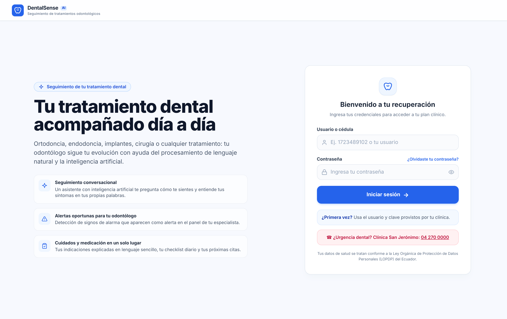

Es la puerta de entrada común a los tres roles. A la izquierda se presentan las funciones del sistema; a la derecha está el formulario con el campo **Usuario o cédula**, el campo **Contraseña** (el ícono del ojo muestra u oculta lo escrito) y el botón **Iniciar sesión**. El enlace **¿Olvidaste tu contraseña?** explica cómo recuperarla en la clínica. El recuadro rojo muestra el teléfono de urgencias y el pie recuerda que los datos se tratan conforme a la LOPDP.

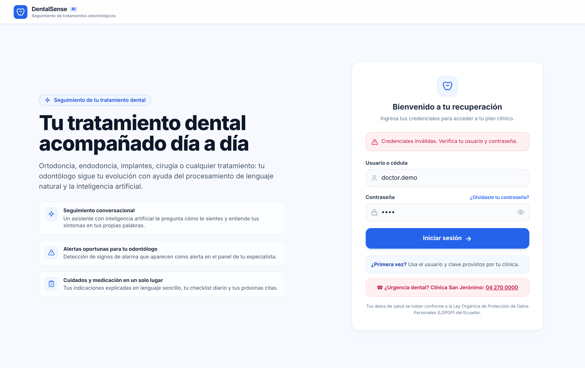

Si el servidor rechaza el usuario o la contraseña, el formulario muestra el mensaje de error devuelto por la API sin recargar la página, y el usuario puede corregir los datos de inmediato.

La pantalla **Consulta médica** del odontólogo es el formulario más extenso del sistema. Su función `handleSubmit` valida todos los campos y, si son correctos, envía un único objeto JSON al servidor:

```jsx
// frontend/src/components/consultation/ConsultationForm.jsx (fragmento)
const handleSubmit = async (event) => {
  event.preventDefault();
  const errors = prescribes ? validateMedication(medication) : {};
  if (!form.clinical_procedure) errors.clinical_procedure = 'Selecciona el tratamiento o intervención.';
  if (!form.surgery_date || form.surgery_date > today())
    errors.surgery_date = 'Indica una fecha de intervención que no sea futura.';
  // … más validaciones
  setFieldErrors(errors);
  if (Object.keys(errors).length > 0) return;

  try {
    const { data } = await api.post('/consultations/', {
      patient: patientId,
      admission_reason: form.admission_reason.trim(),
      clinical_procedure: Number(form.clinical_procedure),
      surgery_date: form.surgery_date,
      teeth: usesTeeth ? teeth : [],                     // piezas marcadas en el odontograma
      instructions: form.instructions.trim(),
      next_control_in_days: Number(form.next_control_in_days || 0),
      prescribes_medication: prescribes,
      ...(prescribes ? medicationPayload(medication, form.instructions) : {}),
    });
    onTreatmentAdded?.(data.treatment);
    setSuccessMsg('Consulta registrada: la receta quedó vinculada al tratamiento activo.');
  } catch (error) {
    setFieldErrors(flattenApiErrors(error.response?.data).errors);  // errores del servidor por campo
  }
};
```

La validación ocurre dos veces: en el cliente, para dar respuesta inmediata, y en el servidor, que es la autoritativa. Si el servidor devuelve `400 Bad Request`, la función `flattenApiErrors` coloca cada mensaje debajo del campo que lo originó.

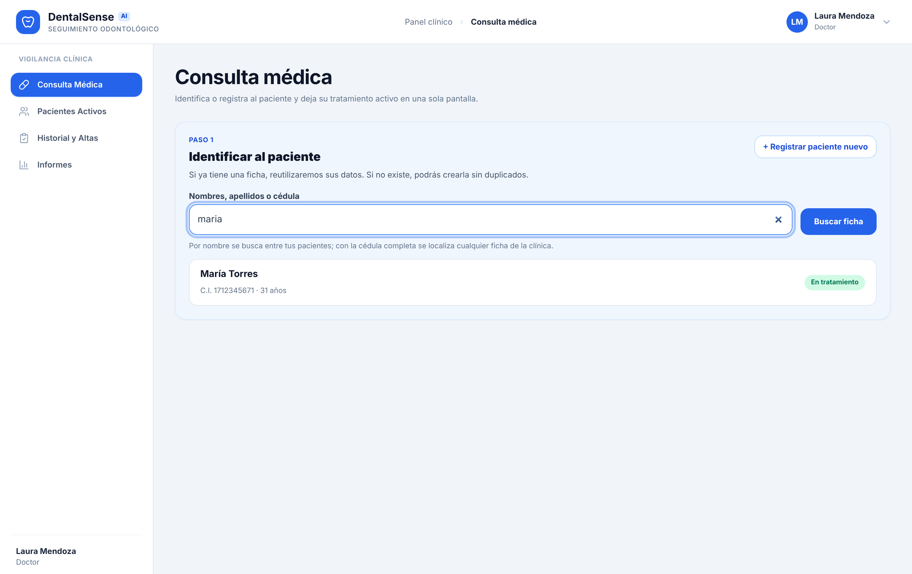

El odontólogo escribe nombres, apellidos o cédula. El hook `useDebouncedValue` espera a que deje de teclear para consultar `GET /api/patients/?search=…`, lo que evita una petición por cada letra. Los resultados indican si el paciente ya tiene un tratamiento activo. El botón **+ Registrar paciente nuevo** despliega el formulario de alta sin salir de la pantalla.

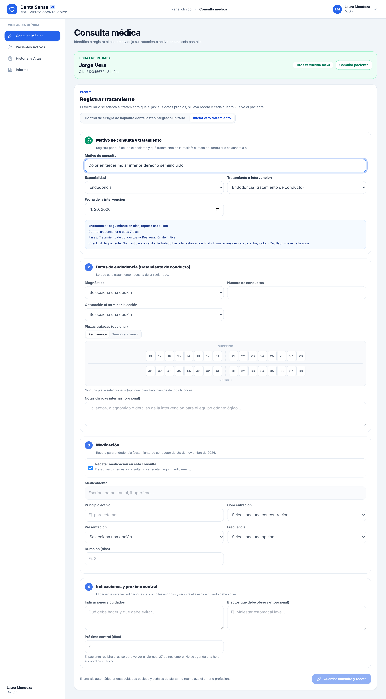

Al seleccionar la **Especialidad** y el **Tratamiento o intervención**, el formulario se adapta al protocolo clínico: muestra los campos propios (en endodoncia, el diagnóstico, el número de conductos y la obturación), un resumen del seguimiento y las fases del tratamiento. El **odontograma** permite marcar las piezas tratadas según la numeración FDI. La casilla **Recetar medicación en esta consulta** muestra u oculta los campos de la receta. El botón **Guardar consulta y receta** se habilita solo cuando los campos obligatorios están completos.

### Visualización de datos con D3.js

El panel del odontólogo dibuja la evolución del dolor del paciente según la Escala Visual Analógica (EVA, de 0 a 10), un instrumento validado para medir la intensidad del dolor (Hawker et al., 2011). La gráfica se construye con D3.js, que vincula datos a elementos SVG del documento (Bostock et al., 2011). React administra el estado (el día seleccionado) y D3 dibuja dentro de un `<svg>` referenciado con `useRef`:

```jsx
// frontend/src/components/charts/PainChart.jsx (fragmento)
const svgRef = useRef(null);
const width  = useChartWidth(boxRef);                 // ancho responsivo del contenedor
const [activeDay, setActiveDay] = useState(null);

useEffect(() => {
  if (!width || !svgRef.current) return;
  renderLineChart(svgRef.current, {
    width, height, lastDay,
    reducedMotion: prefersReducedMotion(),           // respeta la accesibilidad del sistema
    onActivate: setActiveDay,                         // evento: puntero o teclado sobre un día
    lines: [
      { key: 'expected', color: EXPECTED, dashed: true,
        points: expected.map((p) => ({ day: p.day, value: p.expected })) },
      { key: 'reported', color: REPORTED, area: true, dots: true,
        points: reported.map((p) => ({ day: p.day, value: p.reported, fill: LEVEL_FILL[p.color] })) },
    ],
  });
}, [dataKey, width]);
```

La línea punteada es la curva de dolor esperada para el procedimiento; la línea continua es lo que reportó el paciente, con cada punto coloreado según el nivel de alerta (verde, amarillo o rojo). Al pasar el puntero o navegar con el teclado aparece un *tooltip*, y el enlace **Ver datos en tabla** ofrece la misma información en formato tabular para lectores de pantalla.

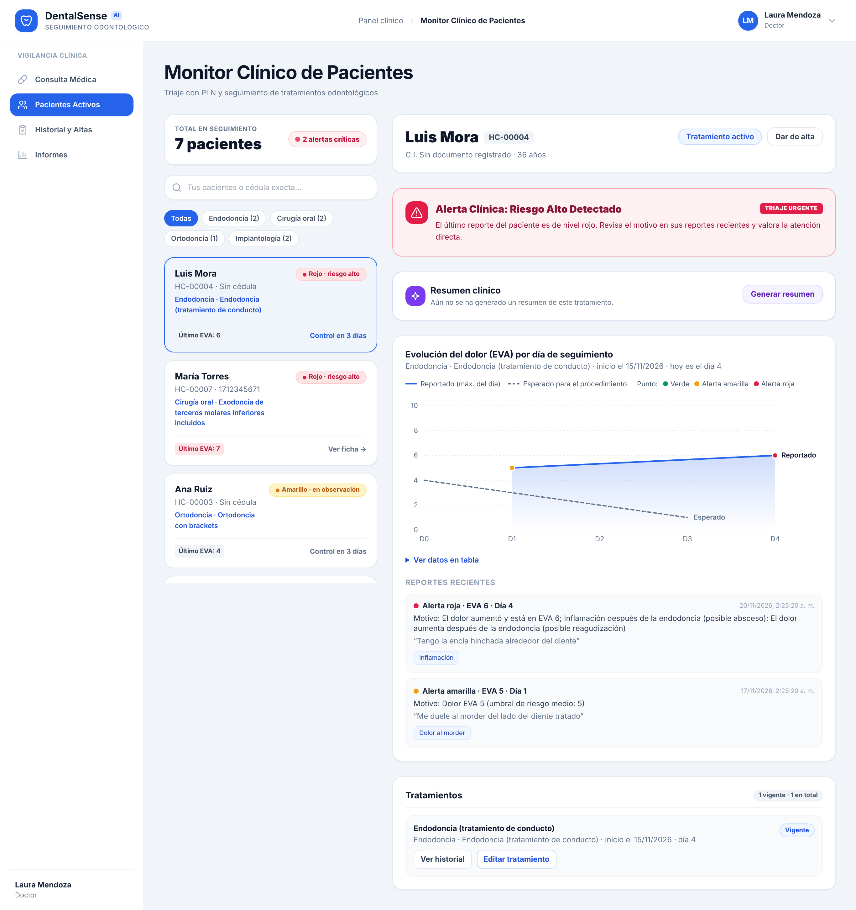

Es la pantalla principal del odontólogo:

- **Columna izquierda:** el total de pacientes en seguimiento, el contador de alertas críticas, un buscador y filtros por especialidad (botones tipo *chip*). Cada tarjeta de paciente muestra su nivel de alerta, el tratamiento, el último valor EVA y la fecha del próximo control. Al hacer clic en una tarjeta, el paciente se carga en la columna derecha.
- **Columna derecha:** si el último reporte es rojo, aparece el aviso **Alerta Clínica: Riesgo Alto Detectado**. Debajo están el botón **Generar resumen**, que pide a la IA un resumen clínico; la gráfica de evolución del dolor; los **reportes recientes** con el motivo de la alerta y los síntomas detectados por el PLN como etiquetas; y la lista de tratamientos con los botones **Ver historial** y **Editar tratamiento**. El botón **Dar de alta** cierra el seguimiento.

### Portal del paciente y asistente conversacional

El paciente informa cómo se siente mediante un asistente conversacional. Para que la respuesta aparezca mientras el modelo la escribe, el cliente consume un flujo de *Server-Sent Events* (SSE) con `fetch` y lo lee por fragmentos:

```js
// frontend/src/services/assistantStream.js (fragmento)
export async function streamAssistantMessage(payload, onDelta) {
  const response = await fetch(`${api.defaults.baseURL}/assistant/messages/stream/`, {
    method: 'POST',
    headers: { 'Content-Type': 'application/json', Accept: 'text/event-stream',
               Authorization: `Bearer ${localStorage.getItem('access_token')}` },
    body: JSON.stringify(payload),
  });
  const reader = response.body.getReader();
  const decoder = new TextDecoder();
  let buffer = '', result = null;
  for (;;) {
    const { value, done } = await reader.read();
    if (done) break;
    buffer += decoder.decode(value, { stream: true });
    // cada evento termina en "\n\n": «delta» trae texto parcial y «done» el resultado final
    // …
    if (event === 'delta') onDelta(data.text);
    else if (event === 'done') result = data;
  }
  return result;
}
```

Se usa `fetch` en lugar de `EventSource` porque este último no permite peticiones `POST` ni cabeceras de autorización. La función de retorno `onDelta` actualiza el estado del mensaje en pantalla con cada fragmento recibido.

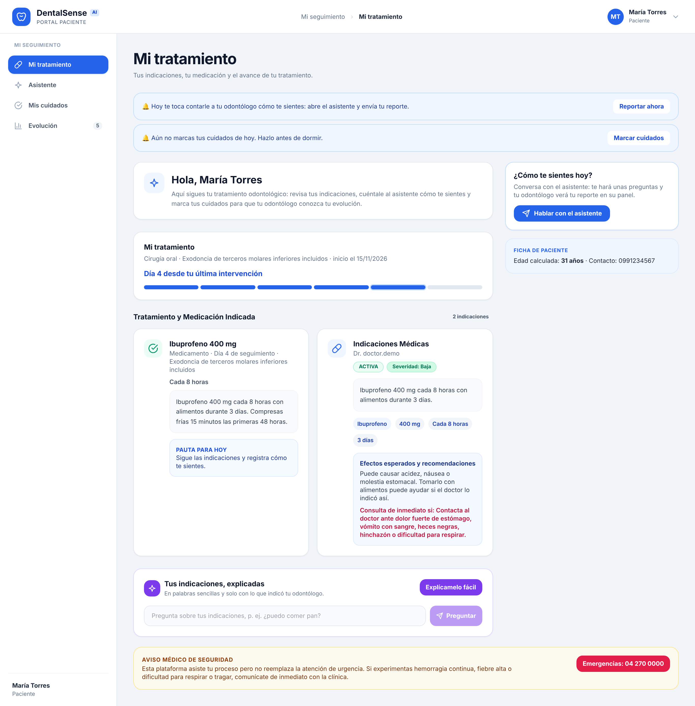

El menú lateral da acceso a **Mi tratamiento**, **Asistente**, **Mis cuidados** y **Evolución**. Los avisos superiores recuerdan las tareas pendientes del día; sus botones **Reportar ahora** y **Marcar cuidados** llevan a la sección correspondiente. La barra de progreso indica el día de seguimiento. Las tarjetas muestran la medicación y las indicaciones del odontólogo, con los datos extraídos por el PLN (medicamento, dosis, frecuencia y duración) como etiquetas. El botón **Explícamelo fácil** pide a la IA una versión en lenguaje sencillo, y el campo **Pregunta sobre tus indicaciones** permite hacer consultas puntuales. El aviso inferior recuerda que la plataforma no reemplaza la atención de urgencia.

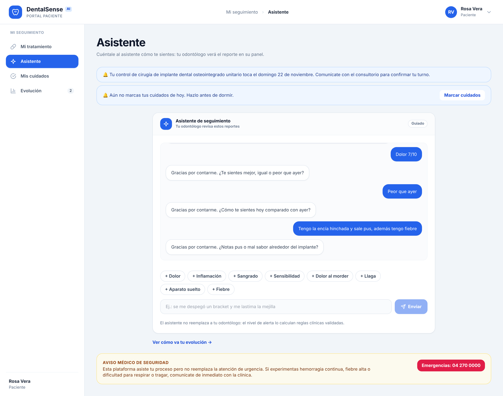

El paciente elige su nivel de dolor con los botones del 0 al 10, indica si está **mejor, igual o peor** que ayer y describe sus síntomas con sus propias palabras. Los botones de acceso rápido (**+ Dolor**, **+ Inflamación**, **+ Sangrado**…) añaden frases frecuentes al mensaje. El asistente repregunta según el tratamiento (en la figura, por signos de infección alrededor de un implante). Al finalizar, el botón **Enviar reporte** envía la información, y el nivel de alerta lo calculan las reglas clínicas del servidor, no el modelo de lenguaje.

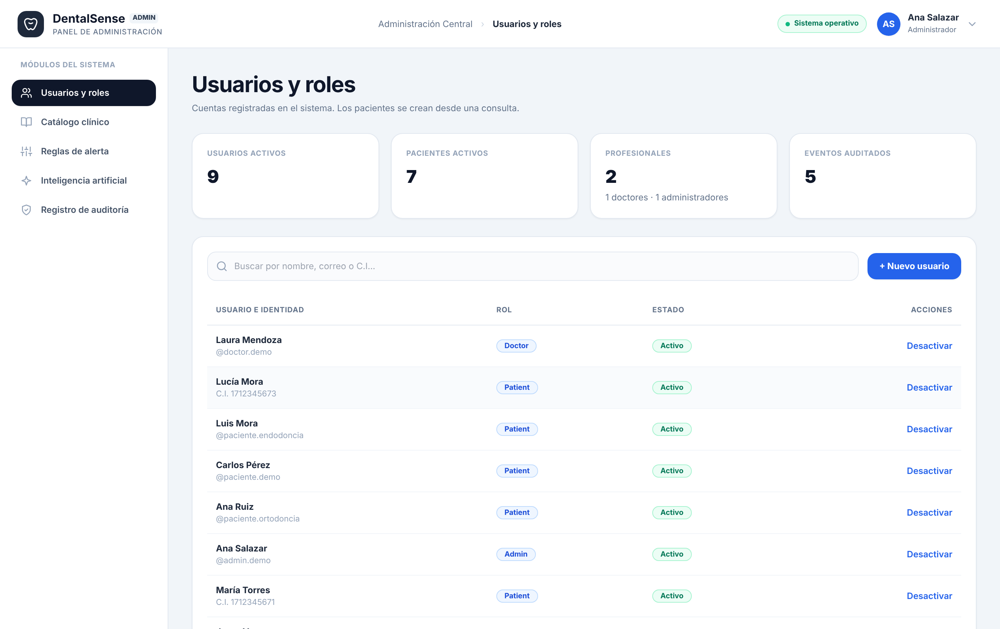

El administrador ve indicadores (usuarios activos, pacientes, profesionales y eventos auditados), busca cuentas y las crea con **+ Nuevo usuario** o las desactiva con **Desactivar**. El menú lateral da acceso al **Catálogo clínico** de protocolos, a las **Reglas de alerta** (umbrales de dolor), a la configuración de **Inteligencia artificial** y al **Registro de auditoría**.

## Back end

### Arquitectura del servidor

El servidor está escrito en Python 3.12 con Django 5.0 y Django REST Framework (DRF). Sigue el patrón modelo–vista–plantilla de Django, adaptado a una API: los **modelos** definen las tablas, los **serializadores** convierten objetos en JSON y validan la entrada, las **vistas** actúan como controladores y los **servicios** concentran la lógica clínica. El proyecto se divide en aplicaciones:

| Módulo | Responsabilidad |
|---|---|
| `core/` | Configuración (`settings.py`), rutas (`urls.py`), paginación y *middleware* de rendimiento |
| `users/` | Modelo de usuario con roles, autenticación JWT con control de inactividad, permisos, cuentas y consentimiento |
| `medical_monitor/` | Recetas, tratamientos, reportes del paciente, triaje, catálogo clínico, auditoría y recordatorios |
| `medical_monitor/nlp.py` | Extracción de entidades clínicas en español con spaCy |
| `medical_monitor/rules/` | Reglas de alerta por especialidad (cirugía, endodoncia, implantes, ortodoncia, periodoncia, prótesis, operatoria) |
| `medical_monitor/ai/` | Cliente de Google Gemini, anonimización, asistente, resúmenes y explicaciones |

### Modelos y acceso a la base de datos

Los modelos se declaran como clases de Python y el ORM de Django los traduce a tablas de PostgreSQL. El modelo de usuario extiende el de Django y añade el rol:

```python
# backend/users/models.py (fragmento)
class User(AbstractUser):
    class Roles(models.TextChoices):
        DOCTOR  = 'DOC', 'Doctor'
        PATIENT = 'PAT', 'Patient'
        ADMIN   = 'ADM', 'Admin'

    role = models.CharField(max_length=3, choices=Roles.choices, default=Roles.PATIENT)
    must_change_password = models.BooleanField(default=False)
    must_accept_terms   = models.BooleanField(default=False)
    last_activity       = models.DateTimeField(null=True, blank=True)
```

El reporte que envía el paciente guarda tanto lo que escribió como el resultado del análisis automático:

```python
# backend/medical_monitor/models.py (fragmento)
class PatientReport(TimeStampedModel):
    patient = models.ForeignKey(settings.AUTH_USER_MODEL, on_delete=models.CASCADE,
                                related_name='postoperative_reports')
    pain_level = models.PositiveSmallIntegerField()                  # EVA 0-10
    comparison = models.CharField(max_length=10, choices=Comparison.choices)
    message = models.TextField(blank=True)
    extracted_entities = models.JSONField(default=list, blank=True) # salida del PLN
    risk_level = models.CharField(max_length=20, default='Bajo')    # Bajo / Medio / Alto
    alert_reasons = models.JSONField(default=list, blank=True)
    postoperative_day = models.PositiveIntegerField(null=True, blank=True)
    treatment_plan = models.ForeignKey('TreatmentPlan', on_delete=models.SET_NULL,
                                       null=True, blank=True, related_name='reports')

    class Meta:
        indexes = [models.Index(fields=['patient', '-created_at'], name='report_patient_recent_idx')]
```

Los campos `JSONField` aprovechan el tipo `jsonb` de PostgreSQL para almacenar listas de entidades sin crear tablas adicionales. Esa extensibilidad de tipos fue un objetivo de diseño de POSTGRES desde su origen (Stonebraker & Rowe, 1986). El índice compuesto acelera la consulta más frecuente: el historial reciente de un paciente.

Las consultas se escriben con el ORM. En el listado de tratamientos se usan `select_related` (un `JOIN` de SQL) y `prefetch_related` para evitar el problema de N+1 consultas, y el conjunto de datos se filtra según quién pregunta:

```python
# backend/medical_monitor/views.py (fragmento)
class TreatmentPlanViewSet(viewsets.ModelViewSet):
    # Todo lo que usa el serializador llega en 2 consultas, sea cual sea el número de tratamientos.
    queryset = TreatmentPlan.objects.select_related(
        'patient', 'clinical_procedure', 'current_phase',
    ).prefetch_related('phases')
    serializer_class = TreatmentPlanSerializer

    def get_queryset(self):
        queryset = super().get_queryset()
        if is_patient(self.request.user):          # el paciente solo ve lo suyo y vigente
            return queryset.filter(patient=self.request.user, is_active=True)
        if self.request.user.role == self.request.user.Roles.DOCTOR:
            queryset = queryset.filter(patient__in=patients_of(self.request.user))
        return queryset
```

### API REST: rutas y controladores

Las rutas se registran en `core/urls.py`. Un `DefaultRouter` genera automáticamente las operaciones CRUD de cada `ViewSet`, y las acciones especiales se declaran con `path`:

```python
# backend/core/urls.py (fragmento)
router = DefaultRouter()
router.register(r'prescriptions',   PrescriptionViewSet,   basename='prescription')
router.register(r'patient-reports', PatientReportViewSet,  basename='patient-report')
router.register(r'treatment-plans', TreatmentPlanViewSet,  basename='treatment-plan')
router.register(r'me',              CurrentUserViewSet,    basename='me')

urlpatterns = [
    path('api/token/',          LoginView.as_view(),   name='token_obtain_pair'),
    path('api/token/refresh/',  RefreshView.as_view(), name='token_refresh'),
    path('api/consultations/',  ConsultationCreateView.as_view()),
    path('api/assistant/messages/stream/', AssistantStreamView.as_view()),
    path('api/assistant/submit/', AssistantSubmitView.as_view()),
    path('api/', include(router.urls)),
]
```

| Método y ruta | Uso | Rol |
|---|---|---|
| `POST /api/token/` | Inicia sesión y devuelve los tokens de acceso y renovación | Todos |
| `POST /api/token/refresh/` | Renueva el token de acceso | Todos |
| `GET /api/me/` | Datos y rol del usuario autenticado | Todos |
| `GET /api/patients/?search=` · `POST /api/patients/` | Busca o registra pacientes | Odontólogo |
| `POST /api/consultations/` | Registra consulta, tratamiento y receta en una transacción | Odontólogo |
| `GET /api/treatment-plans/?patient=` | Tratamientos de un paciente | Odontólogo / paciente |
| `GET /api/patient-reports/` | Reportes del paciente con su nivel de alerta | Odontólogo / paciente |
| `POST /api/assistant/messages/stream/` | Turno del asistente en streaming (SSE) | Paciente |
| `POST /api/assistant/submit/` | Envía el reporte final para el triaje | Paciente |
| `GET /api/reports/summary/` | Indicadores para los informes | Odontólogo |
| `GET /api/audit-events/` | Registro de auditoría | Administrador |

Las rutas siguen la semántica de los métodos HTTP: `GET` consulta sin modificar, `POST` crea un recurso y responde `201 Created`, y los errores se expresan con códigos estándar como `400`, `401`, `403` y `404` (Fielding et al., 2022).

El controlador que registra una consulta muestra el ciclo completo de una petición: comprueba el rol, valida los datos, crea los registros dentro de una **transacción atómica** y responde en JSON.

```python
# backend/medical_monitor/views.py (fragmento)
class ConsultationCreateView(APIView):
    @transaction.atomic                                   # todo o nada
    def post(self, request):
        if request.user.role != request.user.Roles.DOCTOR:
            raise PermissionDenied('Solo el odontólogo puede registrar una consulta.')
        data, errors = request.data, {}
        admission_reason = text(data, 'admission_reason')
        if len(admission_reason) < 5 or len(admission_reason) > 240:
            errors['admission_reason'] = 'Describe el motivo de consulta.'
        # … validación de fecha, piezas dentales, datos del protocolo y receta
        if errors:
            return Response(errors, status=status.HTTP_400_BAD_REQUEST)

        evaluation = evaluate_treatment_plan(title, procedure, details, side_effects)
        treatment = TreatmentPlan.objects.create(patient=patient, procedure=procedure,
                        start_date=start_date, teeth=teeth,
                        treatment_severity=evaluation['severity'], …)
        if medication:
            nlp_result = analyze_medical_text(prescription_details)     # PLN sobre la receta
            prescription = Prescription.objects.create(doctor=request.user, patient=patient,
                        treatment_plan=treatment, extracted_entities=nlp_result['entities'], …)
        create_phases(treatment, clinical_procedure, start_date)
        record_audit(request.user, f'Registró consulta para {patient.username}', 'Consultas')
        return Response({'prescription': …, 'treatment': TreatmentPlanSerializer(treatment).data},
                        status=status.HTTP_201_CREATED)
```

Si cualquier paso falla, `@transaction.atomic` revierte todos los cambios, de modo que no quedan tratamientos sin receta ni recetas huérfanas. Cada acción relevante deja un evento en el registro de auditoría.

### Autenticación, permisos y manejo de sesiones

La API es **sin estado**: no guarda sesiones en el servidor. Cada petición presenta un JWT firmado, que contiene el identificador del usuario y su fecha de expiración (Jones et al., 2015). La configuración global bloquea todo por defecto:

```python
# backend/core/settings.py (fragmento)
REST_FRAMEWORK = {
    'DEFAULT_PAGINATION_CLASS': 'core.pagination.StandardPagination',
    'DEFAULT_AUTHENTICATION_CLASSES': ('users.authentication.IdleAwareJWTAuthentication',),
    'DEFAULT_PERMISSION_CLASSES': [
        'rest_framework.permissions.IsAuthenticated',
        'users.permissions.TermsAccepted',
        'users.permissions.PasswordChangeCompleted',
    ],
    'DEFAULT_THROTTLE_RATES': {'login': '10/min', 'assistant': '30/min', 'ai': '20/hour'},
}
SIMPLE_JWT = {
    'ACCESS_TOKEN_LIFETIME': timedelta(minutes=SESSION_IDLE_TIMEOUT_MINUTES),  # 5 min
    'REFRESH_TOKEN_LIFETIME': timedelta(days=1),
    'AUTH_HEADER_TYPES': ('Bearer',),
    'CHECK_REVOKE_TOKEN': True,   # cambiar la contraseña invalida los tokens anteriores
}
```

- **Autenticación:** la clase personalizada `IdleAwareJWTAuthentication` hereda de la de Simple JWT, valida la firma del token y, además, rechaza la petición si el usuario lleva más de cinco minutos inactivo:

```python
# backend/users/authentication.py (fragmento)
class IdleAwareJWTAuthentication(JWTAuthentication):
    def authenticate(self, request):
        result = super().authenticate(request)          # valida firma y expiración del JWT
        if result is None:
            return None
        user, token = result
        ensure_not_idle(user)                            # 401 con code='session_idle'
        if request.headers.get('X-Background-Request') != '1':
            touch(user)                                  # renueva la última actividad
        return user, token
```

- **Permisos:** `IsAuthenticated` exige un token válido. `TermsAccepted` y `PasswordChangeCompleted` bloquean la API hasta que el paciente acepte el tratamiento de sus datos y cambie su contraseña temporal. Dentro de cada vista se comprueba además el rol (por ejemplo, `require_doctor`).
- **Límites de uso (*throttling*):** como máximo 10 intentos de inicio de sesión por minuto, lo que frena ataques de fuerza bruta, y límites en las llamadas a la IA para acotar su costo. Los contadores se guardan en Redis.

### Servicios: procesamiento de lenguaje natural y triaje

La lógica principal del sistema es clasificar cada reporte del paciente en verde, amarillo o rojo. La extracción de información clínica a partir de texto libre es una aplicación consolidada del PLN en salud, en la que los enfoques basados en reglas siguen siendo los más usados por su transparencia (Wang et al., 2018). El módulo `nlp.py` usa spaCy (Honnibal et al., 2020) con un `EntityRuler` que reconoce síntomas, medicamentos, dosis y frecuencias en español, y detecta además la negación y la intensidad:

```python
# backend/medical_monitor/nlp.py (fragmento)
SYMPTOMS = {
    'Dolor':       ['dolor|dolores|duele|duelen|molestia|molestias|punzada|punzante'],
    'Inflamación': ['inflamacion|inflamado|hinchazon|hinchado|edema'],
    'Fiebre':      ['fiebre|calentura|febril'],
    'Signos de infección': ['pus|supura|supuracion', ['mal', 'olor|sabor|aliento']],
    'Apertura bucal limitada': ['trismo', ['no', 'puedo|logro', 'abrir', 'la?', 'boca']],
    # …
}
```

Así, una frase como «ya no me duele» se marca como síntoma negado y no genera alerta. El servicio `evaluate_patient_status` combina el análisis del texto con el valor EVA, la tendencia y las reglas del protocolo del tratamiento:

```python
# backend/medical_monitor/services.py (fragmento)
def evaluate_patient_status(pain_level, comparison, message, previous_report=None,
                            postoperative_day=None, protocol=None):
    analysis = analyze_medical_text(message)            # spaCy
    thresholds = AlertSettings.load()                   # umbrales configurables por el administrador
    findings = []
    if pain_level >= thresholds.high_pain:
        findings.append(('Alto', f'Dolor EVA {pain_level} (umbral de riesgo alto: {thresholds.high_pain})'))
    elif pain_level >= thresholds.medium_pain:
        findings.append(('Medio', f'Dolor EVA {pain_level} (umbral de riesgo medio: {thresholds.medium_pain})'))
    if comparison == 'higher' and pain_level >= thresholds.rising_pain:
        findings.append(('Alto', f'El dolor aumentó y está en EVA {pain_level}'))
    findings += rules.evaluate(rules.RuleContext(        # reglas por especialidad y día
        symptoms=affirmed_symptoms(analysis['entities']), pain_level=pain_level,
        day=postoperative_day, thresholds=thresholds, protocol=protocol, …))

    risk_level = max((level for level, _ in findings), key=RISK_RANK.get, default='Bajo')
    return {'risk_level': risk_level, 'alert_color': ALERT_COLORS[risk_level],
            'alert_reasons': [...], 'recommendation': ..., 'doctor_notified': risk_level == 'Alto'}
```

Cada especialidad tiene su archivo de reglas. Por ejemplo, la regla común `rules/base.py` eleva a riesgo alto la fiebre con signos de infección y cualquier dificultad para tragar o respirar, y marca como riesgo medio un síntoma que persiste más días de los esperados para el procedimiento. El resultado incluye los **motivos** de la alerta, de modo que el odontólogo sabe por qué se clasificó así el reporte.

### Integración con la IA generativa

El módulo `ai/` usa Google Gemini (Gemini Team, 2023) para tres tareas de apoyo: conversar con el paciente, resumir la evolución clínica para el odontólogo y explicar las indicaciones en lenguaje sencillo. Los modelos de lenguaje tienen un gran potencial en medicina, pero también riesgos de errores y de privacidad (Thirunavukarasu et al., 2023). Por eso el diseño aplica dos salvaguardas:

1. **El triaje nunca depende del modelo.** El nivel de alerta siempre lo calculan las reglas descritas en «Servicios: procesamiento de lenguaje natural y triaje». Si no hay clave de la API o el servicio falla, el sistema usa sus alternativas locales.
2. **Anonimización.** Los ataques de reidentificación sobre datos de salud están documentados (El Emam et al., 2011), por lo que al modelo solo se envía el contexto clínico mínimo, sin identificadores:

```python
# backend/medical_monitor/ai/anonymize.py (fragmento)
def plan_context(plan):
    """Contexto clínico mínimo y sin identificadores para el modelo."""
    return {
        'edad': age_text(plan.patient.age),             # años, nunca la fecha de nacimiento
        'especialidad': procedure.get_specialty_display(),
        'tratamiento': procedure.name,
        'dia_de_seguimiento': plan.postoperative_day,
        'piezas_dentales_fdi': plan.teeth or [],
        'medicacion': ' '.join(filter(None, (plan.medication_name, plan.strength, plan.frequency))),
    }
```

Además, las expresiones regulares del mismo módulo eliminan del texto teléfonos, correos y fechas antes de enviarlo. Cada respuesta del modelo se pide en formato JSON, se valida con Pydantic y queda registrada en la tabla `AIInteraction` para su auditoría.

El asistente responde en *streaming*. La vista devuelve un `StreamingHttpResponse` con tipo `text/event-stream`, y cada fragmento sale en cuanto el modelo lo produce:

```python
# backend/medical_monitor/views_followup.py (fragmento)
def sse(event, data):
    return f'event: {event}\ndata: {json.dumps(data, ensure_ascii=False)}\n\n'

class AssistantStreamView(AssistantView):
    def post(self, request):
        events = assistant.message_events(request.user, *self._message(request), stream=True)
        first = next(events)          # un mensaje no válido responde 400 normal, no un flujo roto
        def body():
            kind, value = first
            while True:
                yield sse(kind, {'text': value} if kind == 'delta' else value)
                kind, value = next(events)
        response = StreamingHttpResponse(body(), content_type='text/event-stream; charset=utf-8')
        response['Cache-Control'] = 'no-cache'
        response['X-Accel-Buffering'] = 'no'          # Nginx no debe acumular la respuesta
        return response
```

### Flujo de peticiones y respuestas entre frontend y backend

La Figura 9 resume lo que ocurre cuando el paciente envía su reporte diario.

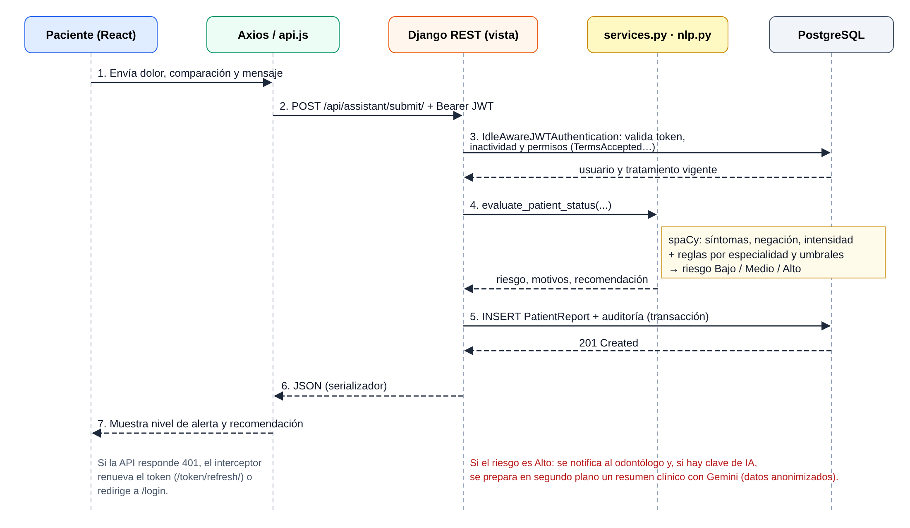


1. El componente `ConversationalAssistant` reúne el dolor, la comparación con el día anterior y el mensaje.
2. `api.js` envía `POST /api/assistant/submit/` con la cabecera `Authorization: Bearer <token>`.
3. Django autentica el token, comprueba la inactividad y aplica los permisos. Si algo falla, responde `401` o `403`.
4. La vista llama a `evaluate_patient_status`, que ejecuta spaCy y las reglas clínicas.
5. El reporte se guarda en PostgreSQL junto con su evento de auditoría.
6. El serializador convierte el resultado en JSON y lo devuelve con `201 Created`.
7. React actualiza la pantalla con el nivel de alerta y la recomendación.

Si el riesgo es alto, el odontólogo recibe la notificación y, si la IA está activa, se prepara en segundo plano un resumen clínico.

Este es un fragmento real de la respuesta JSON de `GET /api/patient-reports/` para un reporte clasificado en rojo:

```json
{
  "count": 5,
  "next": "http://localhost:8000/api/patient-reports/?page=2&page_size=1",
  "results": [{
    "id": 13,
    "pain_level": 7,
    "comparison": "higher",
    "message": "El dolor aumentó mucho y tengo fiebre",
    "extracted_entities": [
      {"text": "dolor",  "label": "SINTOMA", "negated": false, "category": "Dolor",  "intensity": "alta"},
      {"text": "fiebre", "label": "SINTOMA", "negated": false, "category": "Fiebre", "intensity": null}
    ],
    "risk_level": "Alto",
    "alert_color": "rojo",
    "doctor_notified": true,
    "evolution_status": "Requiere revisión",
    "alert_reasons": [
      "Dolor EVA 7 (umbral de riesgo alto: 7)",
      "El dolor aumentó y está en EVA 7",
      "El dolor aumenta después del día 3 (posible alveolitis)"
    ],
    "postoperative_day": 4
  }]
}
```

La respuesta llega paginada (`count`, `next`), incluye las entidades que extrajo el PLN con su negación e intensidad, y explica en `alert_reasons` cada motivo de la alerta. La misma petición sin token devuelve `401 Unauthorized`.

## Integración del sistema

La integración de las capas se realizó en un único equipo de desarrollo con Windows y Docker. Un solo comando de Docker Compose levanta cinco contenedores que se comunican por una red interna y se localizan por el nombre de su servicio (`db`, `redis`, `backend`). El navegador abre siempre la dirección http://localhost:5173, donde Vite sirve la interfaz. Las peticiones a la API no pasan por Vite: el cliente Axios las envía directamente a http://localhost:8000/api, que para el navegador es un origen distinto. Por eso Django autoriza de forma explícita ese origen con `django-cors-headers`. Tampoco usa cookies de sesión ni tokens CSRF: cada petición lleva el token JWT en la cabecera `Authorization: Bearer`. Django, a su vez, se conecta a PostgreSQL 15 mediante psycopg2 y a Redis 7 como caché. La Tabla 1 resume los servicios y los puertos del entorno.

Tabla 1. Servicios y puertos del entorno de ejecución local

| Servicio | Imagen | Dirección | Observación |
|-----------|------------------|--------------|--------------------------------|
| frontend | node:20-alpine | localhost:5173 | Servidor de desarrollo de Vite; ejecuta npm install en cada arranque. |
| backend | python:3.12-slim con el modelo es_core_news_sm de spaCy | localhost:8000 | Aplica las migraciones al arrancar y luego inicia el servidor de desarrollo (runserver 0.0.0.0:8000). |
| db | postgres:15-alpine | localhost:5432 | Base mi_base_datos con el usuario admin; los datos persisten en el volumen postgres_data. |
| redis | redis:7-alpine | Solo red interna (6379) | Caché de catálogos y contadores de límite de uso; 64 MB y sin persistencia en disco. |
| scheduler | La misma imagen del backend | Sin puerto | Envía los recordatorios cada 15 minutos. |

Nota. Elaboración propia a partir de `docker-compose.yml` (commit 389fa9d).

El Código 1 muestra los dos extremos de la conexión entre el frontend y el backend: la dirección base de la API en el cliente y el origen que el servidor acepta. La variable `VITE_API_URL` se fija en `docker-compose.yml` como `http://localhost:8000/api`. Vite la incrusta en el JavaScript que descarga el navegador, por lo que debe ser una dirección alcanzable desde el equipo del usuario, no el nombre interno `backend`.

Código 1. Conexión entre el frontend y la API

```js
// frontend/src/services/api.js (líneas 3–8)
const api = axios.create({
  baseURL: import.meta.env.VITE_API_URL || 'http://localhost:8000/api',
  headers: {
    'Content-Type': 'application/json',
  },
});
```

```python
# backend/core/settings.py (líneas 188–193)
# Permitir que React (Vite) consuma la API
CORS_ALLOW_HEADERS = (*default_headers, 'x-background-request')

CORS_ALLOWED_ORIGINS = [
    "http://localhost:5173",
]
```

Nota. Extractos literales de `frontend/src/services/api.js` y `backend/core/settings.py` (commit 389fa9d).

La configuración sensible se entrega mediante variables de entorno. Docker Compose las toma del archivo `.env` de la raíz del proyecto, que no se versiona (`.gitignore` lo excluye); el repositorio incluye solo `.env.example`, con los nombres y valores de ejemplo. Fuera de Docker, `settings.py` lee el mismo archivo con `django-environ`. La Tabla 2 agrupa las variables principales. En el equipo de desarrollo, `DEBUG` permanece activo; para cualquier instalación distinta de la demostración local debe desactivarse y definirse `SECRET_KEY`, que en ese caso es obligatoria.

Tabla 2. Variables de configuración principales

| Grupo | Variables | Para qué sirven | Valor por defecto |
|----------|------------------------------|------------------------|--------------------|
| Django | DEBUG, SECRET_KEY, ALLOWED_HOSTS | Modo de depuración, clave criptográfica y dominios aceptados. | True en Docker; clave insegura solo con DEBUG; localhost y 127.0.0.1 |
| Base de datos | DB_NAME, DB_USER, DB_PASSWORD, DB_HOST, DB_PORT, DB_CONN_MAX_AGE | Conexión con PostgreSQL y reutilización de conexiones. | mi_base_datos, admin, db en Docker, 5432, 60 s |
| Caché y rendimiento | CACHE_URL, DATA_CACHE_SECONDS, SLOW_REQUEST_MS | Redis compartido, vida de los catálogos en caché y umbral para registrar peticiones lentas. | redis://redis:6379/1 en Docker, 600 s, 800 ms |
| Sesión | SESSION_IDLE_TIMEOUT_MINUTES | Minutos de inactividad tras los que se cierra la sesión (RNF01). | 5 |
| IA generativa | GEMINI_API_KEY, AI_ENABLED, AI_MODEL, AI_TIMEOUT_SECONDS, AI_SUMMARY_ON_ALERT | Clave de Google AI Studio, activación, modelo, tiempo máximo de espera y resumen automático ante una alerta roja. | Sin clave (el sistema usa sus alternativas locales), gemini-4-hydrogen, 20 s |
| Correo | EMAIL_BACKEND, EMAIL_TIMEOUT, DEFAULT_FROM_EMAIL | Mecanismo de envío, tiempo máximo y remitente. | Consola, 10 s, alertas@dentalsense.example |
| Frontend | VITE_API_URL, VITE_SESSION_IDLE_MINUTES, VITE_CDN_URL | Dirección de la API, minutos de inactividad en el navegador y CDN opcional para los estáticos. | http://localhost:8000/api, 5, sin CDN |

Nota. Valores tomados de `backend/core/settings.py`, `docker-compose.yml` y `.env.example`. Elaboración propia.

Para ejecutar el sistema se usan los comandos siguientes desde la raíz del proyecto, después de copiar `.env.example` como `.env`:

```bash
# Construir las imágenes y levantar los cinco servicios
docker compose up --build

# Cargar los datos de demostración (borra los existentes; solo con DEBUG activo)
docker compose exec backend python manage.py seed_demo

# Pruebas
docker compose exec backend python manage.py test --settings=core.settings_test
docker compose exec frontend npm test
```

Sin Docker, el mismo sistema se ejecuta con Python 3.12 o 3.13 y PostgreSQL instalados en el equipo: `pip install -r backend/requirements.txt`, `python -m spacy download es_core_news_sm`, `python manage.py migrate` y `python manage.py runserver` en el backend, y `npm install` y `npm run dev` en el frontend. En ese caso, `DB_HOST` debe ser `localhost`.

La ejecución desatendida corresponde al contenedor `scheduler`, que repite sin fin el comando `manage.py send_reminders` y espera 900 segundos entre una corrida y la siguiente. Cada corrida revisa los tratamientos activos de los pacientes que registraron un correo y calcula tres tipos de recordatorio:

- **Control:** desde tres días antes de la fecha, el mismo día y, si el control se pasó, una vez por semana.
- **Reporte:** cuando vence la frecuencia de autorreporte del protocolo (por defecto, cada día).
- **Cuidados:** después de las 18:00, si el paciente aún no marcó su checklist del día.

Antes de enviar cada recordatorio, el comando lo registra en la tabla `Reminder` con una clave única, por lo que un mismo aviso nunca se repite aunque el comando corra varias veces (Código 2). El correo al odontólogo ante una alerta roja no depende del programador: lo envía el propio backend en un hilo aparte, después de confirmar la transacción, para no retrasar la respuesta al paciente. Todas las fechas se calculan en la zona horaria `America/Guayaquil`.

Código 2. Envío de los recordatorios pendientes

```python
# backend/medical_monitor/reminders.py (líneas 74–95)
def send_pending(now=None):
    """Envía por correo los recordatorios que aún no se enviaron. Devuelve cuántos se enviaron."""
    sent = 0
    plans = TreatmentPlan.objects.filter(is_active=True).exclude(patient__email='').select_related(
        'patient', 'clinical_procedure',
    )
    for plan in plans:
        for item in pending_for_plan(plan, now):
            reminder, created = Reminder.objects.get_or_create(
                kind=item['kind'], key=item['key'], defaults={'user': plan.patient},
            )
            if not created:
                continue
            send_mail(
                subject='DentalSense: recordatorio de tu tratamiento',
                message=f'{item["text"]}\n\nIngresa a tu portal de DentalSense para más detalles.',
                from_email=settings.DEFAULT_FROM_EMAIL,
                recipient_list=[plan.patient.email],
                fail_silently=True,
            )
            sent += 1
    return sent
```

Nota. Extracto literal de `backend/medical_monitor/reminders.py` (commit 389fa9d).

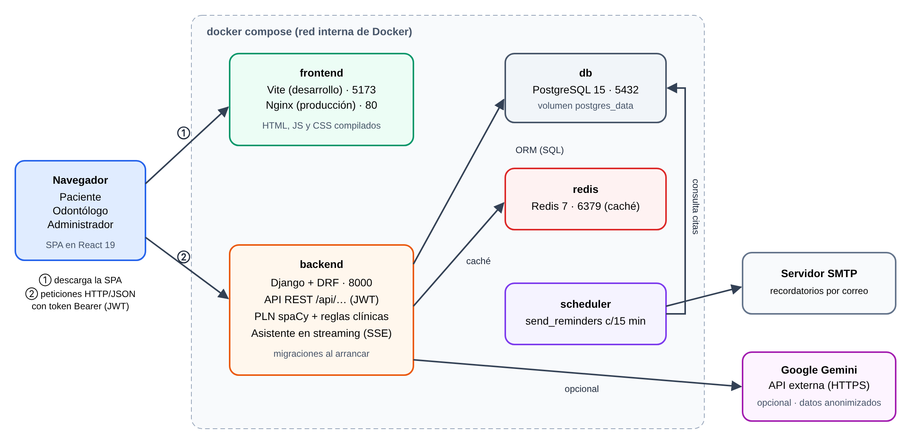

Las capas se conectan como muestra la Figura 10. El navegador descarga la interfaz del contenedor `frontend` (①) y después habla directamente con la API del contenedor `backend` (②). Las vistas de Django llaman a los servicios clínicos, que leen y escriben en PostgreSQL por medio del ORM, consultan la caché en Redis y, solo cuando hace falta y existe una clave, piden a Gemini una respuesta con datos anonimizados. Si Gemini o Redis fallan, el sistema sigue funcionando con sus alternativas locales: el triaje nunca depende de ellos.

El flujo general de uso es el siguiente:

1. El administrador configura el catálogo de tratamientos, los umbrales de alerta y las cuentas del personal.
2. El odontólogo registra la consulta. El backend crea en una sola transacción el tratamiento, sus fases y, si corresponde, la receta, y genera credenciales temporales para el paciente nuevo.
3. El paciente ingresa, acepta el tratamiento de sus datos y cambia su contraseña.
4. Cada día, el programador le recuerda reportar y marcar sus cuidados. El paciente conversa con el asistente y envía su reporte, que el backend clasifica con spaCy y las reglas clínicas en milisegundos.
5. Si el reporte es rojo, la alerta aparece en el Monitor Clínico del odontólogo, sale el correo de aviso y, si la IA está activa, se prepara en segundo plano un resumen clínico.

La Figura 5 y la Figura 7 muestran el sistema funcionando con los datos de demostración: el panel del odontólogo con una alerta roja y el asistente del paciente durante un reporte.

Las limitaciones de la operación local son las siguientes:

- **Origen único.** La interfaz debe abrirse como http://localhost:5173. Si se abre como http://127.0.0.1:5173, o desde otro dispositivo de la red, el navegador bloquea las respuestas de la API porque ese origen no está en `CORS_ALLOWED_ORIGINS`. Se comprobó enviando la consulta previa de CORS con ambos orígenes: solo `localhost` recibió la cabecera `Access-Control-Allow-Origin`. Para usar el sistema desde un teléfono hay que ajustar `CORS_ALLOWED_ORIGINS` y `VITE_API_URL`.
- **Correo en consola.** Con el valor por defecto de `EMAIL_BACKEND`, los recordatorios y las alertas se escriben en el registro de los contenedores en lugar de enviarse. Para un envío real hay que elegir el backend SMTP de Django, y además `settings.py` todavía no lee de variables de entorno el servidor, el puerto ni las credenciales SMTP.
- **Programador sin recuperación.** Si el contenedor `scheduler` está detenido, no se envían recordatorios. Al reiniciarse solo envía los que siguen vigentes, de modo que los avisos de los días en que estuvo detenido se pierden.
- **Servidores de desarrollo.** El backend y el frontend corren con sus servidores de desarrollo (`runserver` y Vite). Para producción, el frontend ya tiene su imagen con Nginx (`frontend/Dockerfile.prod`), pero el backend aún necesita un servidor WSGI como Gunicorn.
- **Puerto de la base de datos publicado.** El puerto 5432 se expone en el equipo para facilitar la inspección durante el desarrollo; fuera de él debe cerrarse.

## Pruebas funcionales y resultados

### Estrategia de pruebas

El prototipo se verificó en cuatro niveles complementarios. Automatizar las pruebas permite repetirlas después de cada cambio con el mismo criterio, algo especialmente valioso en las pruebas de regresión (Garousi & Mäntylä, 2016).

1. **Pruebas unitarias y de integración del backend.** Comprueban cada servicio (PLN, triaje, reglas por especialidad, IA) de forma aislada, y cada endpoint de la API con su autenticación, permisos y acceso a la base de datos. Usan el sistema de pruebas de Django sobre una base SQLite en memoria, de modo que nunca tocan datos reales.
2. **Pruebas unitarias y de componentes del frontend.** Con Vitest, React Testing Library y jsdom, cada pantalla se monta en un navegador simulado, se reproducen las acciones del usuario (escribir, hacer clic, enviar) y se verifica lo que se muestra. Las respuestas de la API se simulan.
3. **Pruebas funcionales de extremo a extremo.** Recorren el sistema completo (PostgreSQL, Redis, Django y Vite) desde un navegador Chromium real controlado con Playwright, tal como lo usaría una persona. Este tipo de prueba valida que todas las capas funcionen juntas (Leotta et al., 2016).
4. **Pruebas de rendimiento y evaluación del PLN.** Miden el tiempo de respuesta del autorreporte y la exactitud de la extracción de síntomas con métricas de clasificación (Sokolova & Lapalme, 2009).

Todas las pruebas se ejecutaron el 19 de noviembre de 2026 sobre la versión actual del código, con Python 3.13, Node.js 22 y PostgreSQL 16. Para las pruebas funcionales se usaron los datos de demostración del proyecto (`seed_demo` y `datos_demostracion.py`) y un navegador configurado con la zona horaria de Ecuador (`America/Guayaquil`).

### Pruebas unitarias y de integración

Comando: `python manage.py test --settings=core.settings_test` (backend) y `npm test` (frontend).

| Módulo de pruebas | Qué evalúa | Pruebas | Resultado |
|----------------------|--------------------------------|--------|--------------|
| `tests_requirements.py` | Criterios de aceptación de RF01–RF04 y RNF01–RNF02 | 29 | 29 aprobadas |
| `tests_api.py` | Endpoints de autenticación, recetas, tratamientos, reportes, búsqueda de medicamentos y consultas | 64 | 64 aprobadas |
| `tests_services.py` y `tests.py` | PLN (síntomas, negación, intensidad), triaje y análisis de recetas | 46 | 46 aprobadas |
| `tests_specialties.py` | Vocabulario ampliado y reglas por especialidad | 18 | 18 aprobadas |
| `tests_ai.py` | Anonimización, cliente de Gemini, asistente (local y con LLM), streaming, resúmenes y explicaciones | 34 | 34 aprobadas |
| `tests_followup.py` | Formularios por protocolo, fases, controles, checklist de cuidados y recordatorios | 29 | 28 aprobadas, 1 fallida |
| `tests_clinical.py` | Umbrales de alerta, auditoría, catálogo, informes, altas, notificaciones y seguridad | 19 | 19 aprobadas |
| `tests_treatments.py` | Edición, historial y alta de tratamientos | 18 | 18 aprobadas |
| `tests_performance.py` y `tests_migrations.py` | Número de consultas SQL por listado, caché y migración de datos | 6 | 6 aprobadas |
| `users/tests*.py` | Usuarios, perfiles, cuentas, contraseñas, registro de pacientes y consentimiento | 64 | 64 aprobadas |
| **Total backend** | | **327** | **326 aprobadas (99,7 %)** |
| 17 archivos `*.test.jsx` / `*.test.js` | Inicio de sesión, rutas por rol, contexto de sesión e inactividad, interceptores de la API, panel del odontólogo, consulta, portal del paciente, gráficas, cuenta, consentimiento e historial | **188** | **188 aprobadas (100 %)** |

**Análisis de la prueba fallida.** `test_send_reminders_once_by_email` espera que el comando de recordatorios envíe un solo correo, pero envió dos. La causa no es un defecto del sistema sino de la propia prueba: después de las 18:00 (`CARE_REMINDER_HOUR = 18`), el comando también envía, con razón, el recordatorio de cuidados del día, y la prueba usa la hora real del reloj. La suite se ejecutó a las 21:56 (hora de Ecuador). Al repetir las pruebas de recordatorios con el reloj fijado a las 11:00, todas pasaron. La corrección consiste en fijar la hora dentro de la prueba.

### Casos de prueba funcionales

La tabla siguiente resume los 22 casos de prueba de extremo a extremo. En la columna «Resultado obtenido» se registra lo que realmente devolvió el sistema durante la ejecución.

| N.º | Funcionalidad probada | Entrada o acción | Resultado esperado | Resultado obtenido | Estado |
|--------|-----------------|------------------|--------------|----------------|----------|
| PF01 | Inicio de sesión del odontólogo | doctor.demo con contraseña válida | Ingresa a /panel-doctor | Redirigido a /panel-doctor | Cumple |
| PF02 | Inicio de sesión del paciente | maria.torres con contraseña válida | Ingresa a /panel-paciente | Redirigido a /panel-paciente | Cumple |
| PF03 | Credenciales inválidas | doctor.demo con contraseña errónea | Permanece en /login con mensaje de error | Mensaje «Credenciales inválidas. Verifica tu usuario y contraseña.» | Cumple |
| PF04 | Control de acceso por rol (interfaz) | El paciente abre /panel-doctor | Redirige a su propio panel | Redirigido a /panel-paciente | Cumple |
| PF05 | Control de acceso por rol (API) | El paciente envía POST /api/consultations/ | HTTP 403 Forbidden | HTTP 403 | Cumple |
| PF06 | Protección de la API sin token | GET /api/patient-reports/ sin cabecera Authorization | HTTP 401 Unauthorized | HTTP 401 | Cumple |
| PF07 | Priorización de pacientes por alerta | Abrir el Monitor Clínico | La lista empieza por las alertas rojas | Primera etiqueta: «Rojo · riesgo alto» | Cumple |
| PF08 | Gráfica de evolución del dolor (EVA) | Seleccionar un paciente | Se dibuja la curva con los puntos reportados | 9 puntos dibujados en el SVG | Cumple |
| PF09 | Alternativa accesible de la gráfica | Clic en «Ver datos en tabla» | Tabla con los mismos datos | Tabla con 4 filas | Cumple |
| PF10 | Búsqueda de paciente | Escribir «Jorge» en el buscador | Muestra la ficha del paciente | Ficha de Jorge Vera encontrada | Cumple |
| PF11 | Validación del formulario de consulta | Intentar guardar con el formulario vacío | No permite guardar | Botón «Guardar» deshabilitado; no se envía nada | Cumple |
| PF12 | Registro de consulta y tratamiento | Endodoncia con motivo, datos del protocolo e indicaciones, sin receta | HTTP 201 y mensaje de confirmación | HTTP 201 · «Consulta registrada: el tratamiento quedó activo, sin receta.» | Cumple |
| PF13 | Extracción de síntomas con PLN | «Tengo la encía hinchada, sale pus y tengo fiebre» | Detecta inflamación, signos de infección y fiebre | Dolor, Inflamación, Signos de infección, Fiebre | Cumple |
| PF14 | Triaje del autorreporte | EVA 8, «peor que ayer», fiebre con pus | Alerta roja y odontólogo notificado | Riesgo Alto · rojo · notificado | Cumple |
| PF15 | Alerta visible para el odontólogo | Abrir al paciente que acaba de reportar | Aviso de riesgo alto en el panel | Aviso «Alerta Clínica: Riesgo Alto Detectado» mostrado | Cumple |
| PF16 | Detección de negaciones | EVA 1, «mejor», «Ya no me duele, sin sangrado ni fiebre» | Los tres síntomas se marcan como negados; alerta verde | Negados: duele, sangrado, fiebre · riesgo Bajo (verde) | Cumple |
| PF17 | Cierre de sesión por inactividad (RNF01) | Usar un token válido tras 6 minutos sin actividad | HTTP 401 con código session_idle | Antes: HTTP 200 · después: HTTP 401 (session_idle) | Cumple |
| PF18 | Límite de intentos de inicio de sesión | 11 intentos fallidos en un minuto | El intento 11 se bloquea | Intento 11: HTTP 429 Too Many Requests | Cumple |
| PF19 | Diseño adaptable (RNF03) | Portal del paciente a 320 px de ancho | Sin desplazamiento horizontal | Ancho visible 320 px · contenido 320 px | Cumple |
| PF20 | Gestión de usuarios (administrador) | admin.demo abre «Usuarios y roles» | Lista las cuentas con su rol y estado | 9 cuentas listadas | Cumple |
| PF21 | Estabilidad de la interfaz | Recorrido completo de los casos anteriores | Sin errores de JavaScript | 0 errores en la consola | Cumple |
| PF22 | Registro de consulta desde otra zona horaria | Equipo configurado en UTC registra una consulta con la fecha de «hoy» de su navegador (20/11/2026) a las 03:01 UTC, que en Ecuador aún era 19/11/2026 | HTTP 201: la consulta se registra | HTTP 400 · «La fecha de la intervención no puede estar en el futuro.» | No cumple |

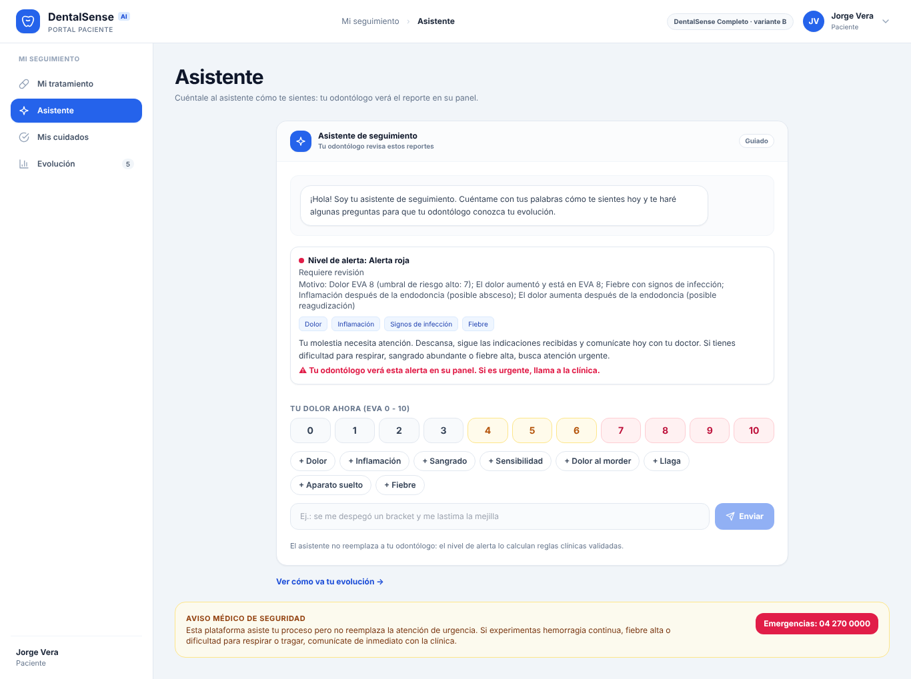

La Figura 11 muestra lo que ve el paciente al terminar el caso PF14. El sistema clasificó el reporte como **alerta roja** y explica cada motivo (dolor EVA 8 sobre el umbral, aumento del dolor, fiebre con signos de infección e inflamación compatible con un absceso tras la endodoncia). También muestra como etiquetas los síntomas detectados por el PLN y avisa al paciente de que su odontólogo verá la alerta en su panel.

**Análisis del caso PF22.** La interfaz propone como fecha de la intervención el día actual *del navegador*, mientras que la API valida contra el día actual *del servidor* (`America/Guayaquil`). Si el equipo del usuario está configurado en otra zona horaria, entre las 19:00 y las 24:00 de Ecuador su «hoy» ya es el día siguiente, y la API lo rechaza como fecha futura. Un usuario en Ecuador con su equipo bien configurado no se ve afectado (PF12 pasó con la zona horaria correcta), pero el defecto es real. Se corrige calculando la fecha por defecto en la zona horaria de la clínica (por ejemplo, entregándola desde la API) en lugar de la del navegador.

### Pruebas de rendimiento y evaluación del PLN

**Rendimiento (RNF02).** El comando `python manage.py measure_report_latency --requests 100` envió 100 autorreportes por la pila completa (autenticación JWT, PLN, reglas y base de datos PostgreSQL).

| Indicador | Valor medido | Umbral (RNF02) | Estado |
|---|---|---|---|
| Mediana | 7,5 ms | — | — |
| Percentil 95 | 11,3 ms | — | — |
| Máximo | 48,4 ms | 200 ms | Cumple |

**Exactitud del PLN.** El comando `python manage.py evaluate_nlp` compara lo que extrae el PLN con 124 frases escritas como las escribiría un paciente y etiquetadas a mano, de las nueve especialidades. Solo se cuentan los síntomas afirmados, por lo que «ya no me duele» no debe producir «Dolor».

| Métrica | Resultado |
|---|---|
| Precisión | 98,0 % |
| Exhaustividad (*recall*) | 84,7 % |
| F1 | 90,9 % |
| Frases con extracción exacta | 85,5 % |
| Frases sin síntomas correctamente vacías | 100 % (15 de 15) |
| Latencia por frase | mediana 1,9 ms; máximo 4,2 ms |

La precisión de 98 % significa que casi nunca se detecta un síntoma inexistente, lo que evita falsas alarmas. La exhaustividad de 84,7 % indica que algunas expresiones aún no se reconocen. Los errores se concentran en frases como «el diente se siente flojo» (movilidad dental), «se me partió el diente» (fractura de la restauración) o «se me soltó una liga» (aparato suelto). Ninguna frase negada produjo síntomas, lo que coincide con los enfoques clásicos de detección de negación en textos clínicos basados en palabras disparadoras cercanas (Chapman et al., 2001).

### Resumen de resultados

| Tipo de prueba | Ejecutadas | Aprobadas | Porcentaje |
|---|---|---|---|
| Unitarias e integración (backend) | 327 | 326 | 99,7 % |
| Unitarias y componentes (frontend) | 188 | 188 | 100 % |
| Funcionales de extremo a extremo | 22 | 21 | 95,5 % |
| Rendimiento (100 autorreportes ≤ 200 ms) | 1 | 1 | 100 % |
| **Total** | **538** | **536** | **99,6 %** |

Las funcionalidades principales operan correctamente: autenticación y control de acceso, registro de consultas, extracción de síntomas, triaje, alertas al odontólogo, cierre de sesión por inactividad y diseño adaptable. Las dos pruebas fallidas no afectan al uso normal desde Ecuador, pero quedan registradas como mejoras: una prueba que depende de la hora del reloj y la validación de fechas entre zonas horarias distintas.

# Conclusiones y recomendaciones

## Conclusiones

1. **Se cumplió el objetivo de construir un prototipo funcional de seguimiento odontológico a distancia.** DentalSense AI permite que el odontólogo registre el tratamiento, que el paciente informe a diario cómo se siente y que el sistema clasifique cada reporte en verde, amarillo o rojo. La información que el paciente escribe desde su teléfono llega clasificada al panel del odontólogo en milisegundos, lo que acerca a la práctica odontológica el monitoreo remoto tras una intervención, cuya viabilidad y aceptación ya están documentadas en cirugía (Dawes et al., 2021).

2. **Los requisitos funcionales y no funcionales se verificaron con pruebas automatizadas.** Se ejecutaron 538 pruebas y el 99,6 % fue aprobado. Las pruebas cubren la autenticación y el control de acceso por rol (RF01), el procesamiento de los autorreportes con PLN (RF02), el panel del odontólogo con la curva de dolor (RF03), el registro de procedimientos (RF04), el cierre de sesión a los cinco minutos de inactividad (RNF01), el tiempo de respuesta (RNF02: máximo de 48,4 ms frente a un umbral de 200 ms) y el uso desde pantallas de 320 px (RNF03).

3. **El PLN local basado en reglas resultó adecuado para el triaje clínico.** Con una precisión del 98 % y un F1 del 90,9 %, spaCy con un `EntityRuler` detecta síntomas, su intensidad y sus negaciones en el español coloquial de los pacientes, en menos de 2 ms por frase, sin enviar datos fuera del servidor. Su principal ventaja es que cada alerta va acompañada de sus motivos, de modo que el odontólogo sabe por qué se clasificó así el reporte. Esa transparencia sigue siendo la razón por la que los sistemas basados en reglas predominan en la extracción de información clínica (Wang et al., 2018).

4. **La combinación de PLN local con un modelo de lenguaje fue la decisión de diseño más relevante.** El modelo de lenguaje (Gemini) aporta lo que hace mejor: conversar, resumir y explicar en lenguaje sencillo. El nivel de alerta, en cambio, siempre lo deciden reglas validables. Así se aprovecha la IA generativa sin depender de ella ni exponerse a sus errores en una decisión clínica, uno de los riesgos señalados para su uso en medicina (Thirunavukarasu et al., 2023). Si el servicio externo falla o no hay clave, el sistema sigue funcionando en modo guiado.

5. **La privacidad se incorporó desde el diseño.** El consentimiento informado, la anonimización de lo que se envía al modelo, el cierre de sesión por inactividad, el límite de intentos de inicio de sesión y el registro de auditoría responden a la LOPDP y al riesgo documentado de reidentificación en datos de salud (El Emam et al., 2011).

6. **Lecciones aprendidas.**
   - Validar en el cliente y en el servidor a la vez mejora la experiencia sin sacrificar la seguridad.
   - Medir antes de optimizar fue decisivo: una prueba que cuenta las consultas SQL redujo un listado de 22 consultas a 5 fijas.
   - Las pruebas de extremo a extremo revelaron un defecto que las pruebas unitarias no podían ver: la diferencia de zona horaria entre el navegador y el servidor (PF22). También mostraron que las pruebas que dependen del reloj real son frágiles. Ambos casos confirman el valor de probar el sistema completo en condiciones reales.
   - Contenerizar los servicios con Docker hizo el entorno reproducible y simplificó la integración de las cinco piezas del sistema (Boettiger, 2015).

7. **Aportes del proyecto.** En lo técnico, el proyecto deja una arquitectura reutilizable para seguimiento clínico a distancia: reglas por especialidad configurables, un vocabulario clínico en español con detección de negación y un patrón de integración seguro con IA generativa. En lo académico, aporta un conjunto de evaluación de 124 frases etiquetadas y una trazabilidad completa entre requisitos, código, pruebas y evidencias.

## Recomendaciones

1. **Corregir los dos defectos encontrados.** Calcular la fecha por defecto de la intervención en la zona horaria de la clínica (PF22) y fijar la hora en la prueba de recordatorios para que su resultado no dependa del momento en que se ejecuta.
2. **Ampliar el vocabulario del PLN** con las expresiones que hoy no reconoce (movilidad dental, fracturas de restauraciones, aparatos sueltos), para subir la exhaustividad por encima del 90 %, y repetir la evaluación con frases de pacientes reales.
3. **Validar las reglas de triaje con especialistas** de cada área y con casos clínicos reales antes de un uso asistencial, como exige la ficha de RF02.
4. **Realizar pruebas de usabilidad con pacientes y odontólogos** en dispositivos físicos, aplicando un instrumento estandarizado como la System Usability Scale (Bangor et al., 2008), ya que la verificación a 320 px se hizo solo en un navegador emulado.
5. **Desplegar en la nube** con la imagen de producción ya preparada (Nginx y Django detrás de HTTPS), una base de datos gestionada, copias de seguridad automáticas y el servicio de recordatorios como tarea programada del proveedor (Pahl, 2015).
6. **Reforzar la seguridad.** Guardar los tokens en cookies `HttpOnly` en lugar de `localStorage`, añadir un segundo factor de autenticación para el personal clínico y someter el sistema a un análisis de vulnerabilidades antes de manejar datos reales.
7. **Incorporar nuevos módulos**: envío de fotografías de la zona tratada, notificaciones *push* en el teléfono, agenda de citas integrada con la clínica y un tablero de indicadores para la gestión del consultorio.
8. **Comparar el PLN local con el modelo de lenguaje** ejecutando `evaluate_nlp --llm` con una clave de Gemini, para medir si el modelo mejora la exhaustividad y decidir si conviene usarlo como apoyo en la extracción, sin que deje de decidir la alerta el motor de reglas.

# Referencias

Bangor, A., Kortum, P. T., & Miller, J. T. (2008). An empirical evaluation of the System Usability Scale. *International Journal of Human–Computer Interaction, 24*(6), 574–594. https://doi.org/10.1080/10447310802205776

Boettiger, C. (2015). An introduction to Docker for reproducible research. *ACM SIGOPS Operating Systems Review, 49*(1), 71–79. https://doi.org/10.1145/2723872.2723882

Bostock, M., Ogievetsky, V., & Heer, J. (2011). D³ data-driven documents. *IEEE Transactions on Visualization and Computer Graphics, 17*(12), 2301–2309. https://doi.org/10.1109/TVCG.2011.185

Chapman, W. W., Bridewell, W., Hanbury, P., Cooper, G. F., & Buchanan, B. G. (2001). A simple algorithm for identifying negated findings and diseases in discharge summaries. *Journal of Biomedical Informatics, 34*(5), 301–310. https://doi.org/10.1006/jbin.2001.1029

Dawes, A. J., Lin, A. Y., Varghese, C., Russell, M. M., & Lin, A. Y. (2021). Mobile health technology for remote home monitoring after surgery: A meta-analysis. *British Journal of Surgery, 108*(11), 1304–1314. https://doi.org/10.1093/bjs/znab323

El Emam, K., Jonker, E., Arbuckle, L., & Malin, B. (2011). A systematic review of re-identification attacks on health data. *PLoS ONE, 6*(12), Artículo e28071. https://doi.org/10.1371/journal.pone.0028071

Fielding, R. T., & Taylor, R. N. (2002). Principled design of the modern Web architecture. *ACM Transactions on Internet Technology, 2*(2), 115–150. https://doi.org/10.1145/514183.514185

Fielding, R. T., Nottingham, M., & Reschke, J. (Eds.). (2022). *HTTP semantics* (RFC 9110). RFC Editor. https://doi.org/10.17487/RFC9110

Garousi, V., & Mäntylä, M. V. (2016). When and what to automate in software testing? A multi-vocal literature review. *Information and Software Technology, 76*, 92–117. https://doi.org/10.1016/j.infsof.2016.04.015

Gemini Team. (2023). *Gemini: A family of highly capable multimodal models* (arXiv:2312.11805). arXiv. https://doi.org/10.48550/arXiv.2312.11805

Hawker, G. A., Mian, S., Kendzerska, T., & French, M. (2011). Measures of adult pain: Visual Analog Scale for Pain (VAS Pain), Numeric Rating Scale for Pain (NRS Pain), McGill Pain Questionnaire (MPQ), Short-Form McGill Pain Questionnaire (SF-MPQ), Chronic Pain Grade Scale (CPGS), Short Form-36 Bodily Pain Scale (SF-36 BPS), and Measure of Intermittent and Constant Osteoarthritis Pain (ICOAP). *Arthritis Care & Research, 63*(S11), S240–S252. https://doi.org/10.1002/acr.20543

Honnibal, M., Montani, I., Van Landeghem, S., & Boyd, A. (2020). *spaCy: Industrial-strength natural language processing in Python* [Software]. Zenodo. https://doi.org/10.5281/zenodo.1212303

Jones, M., & Hardt, D. (2012). *The OAuth 2.0 authorization framework: Bearer token usage* (RFC 6750). RFC Editor. https://doi.org/10.17487/RFC6750

Jones, M., Bradley, J., & Sakimura, N. (2015). *JSON Web Token (JWT)* (RFC 7519). RFC Editor. https://doi.org/10.17487/RFC7519

Leotta, M., Clerissi, D., Ricca, F., & Tonella, P. (2016). Approaches and tools for automated end-to-end web testing. En A. Memon (Ed.), *Advances in Computers* (Vol. 101, pp. 193–237). Elsevier. https://doi.org/10.1016/bs.adcom.2015.11.007

Pahl, C. (2015). Containerization and the PaaS cloud. *IEEE Cloud Computing, 2*(3), 24–31. https://doi.org/10.1109/MCC.2015.51

Sokolova, M., & Lapalme, G. (2009). A systematic analysis of performance measures for classification tasks. *Information Processing & Management, 45*(4), 427–437. https://doi.org/10.1016/j.ipm.2009.03.002

Stonebraker, M., & Rowe, L. A. (1986). The design of POSTGRES. *ACM SIGMOD Record, 15*(2), 340–355. https://doi.org/10.1145/16856.16888

Thirunavukarasu, A. J., Ting, D. S. J., Elangovan, K., Gutierrez, L., Tan, T. F., & Ting, D. S. W. (2023). Large language models in medicine. *Nature Medicine, 29*(8), 1930–1940. https://doi.org/10.1038/s41591-023-02448-8

Wang, Y., Wang, L., Rastegar-Mojarad, M., Moon, S., Shen, F., Afzal, N., Liu, S., Zeng, Y., Mehrabi, S., Sohn, S., & Liu, H. (2018). Clinical information extraction applications: A literature review. *Journal of Biomedical Informatics, 77*, 34–49. https://doi.org/10.1016/j.jbi.2017.11.011
